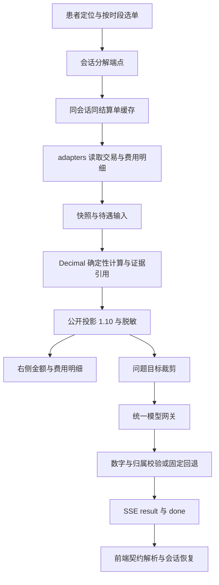

# 四链路结算解释对抗性代码评审

日期：2026-10-26。对象：issue-78 工作区当前实现（HEAD `294eded` 及现有未提交改动），本地服务 8109/3109。按用户给出的四组人员与结算单对应关系只读验证，本文仅使用结算单尾号，不回显证件号。

**结论：暂不满足“每个展示金额和费用项目都能解释”的验收标准。共确认 10 项问题，其中 5 项 P1、5 项 P2；本轮只评审，未修改业务代码、金额算法、源结算记录或启停服务。**

主要问题是解释出口的正确性和覆盖完整性。四单可定位、金额有可追溯的分解载荷、明细均可读，但“有金额/有说明/接口成功”不能证明“讲清楚且讲对”。真实问答已出现错误算式被放行、总览被裁成一行；模型回退也会丢掉关键计算依据。

## 1. 范围与实际验证结果

| 链路 | 单号尾号 | 总费用 | 基金/保障构成 | 最终个人 | 展示金额项 | 后端标记可解释 | 明细行 | 真实 SSE |
|---|---|---:|---|---:|---:|---:|---:|---:|
| 居民普通门诊 | 0408…000002 | 3435.00 | 大额 1597.50 | 1837.50 | 19 | 9 | 6 | 29 |
| 居民门特·项目 | 688 | 1187.00 | 基本医保 837.83＋大病 226.96＋救助 122.21 | 0.00 | 17 | 10 | 2 | 23 |
| 职工普通门诊 | 1118…000008 | 3000.00 | 大额 420.00 | 2580.00 | 19 | 9 | 1 | 24 |
| 职工门特·项目 | 567 | 6000.00 | 统筹 4277.00＋退休补助 211.50＋军残补助 1511.50 | 0.00 | 19 | 14 | 1 | 24 |
| 合计 | | | | | **74** | **42** | **10** | **100** |

“后端标记可解释”来自公开字段的 `explainable`，包含明细汇总，不等于外部政策已核证，也不等于本轮回答通过人工内容审查。未计入的项目包括不适用待遇、支付渠道原单事实、账面关系、计算构成和实际资料缺口，不能简单当作 32 个算法错误。

- 四个人员均在真实浏览器中定位并选中指定单；四条页面流程均读取到正确核心金额。
- 100 次真实 SSE：100 次 `partial`，全部有 `result/done`。覆盖 74 个单字段问题、10 行费用问题、4 个总览、12 个混合/错误名称问题。
- 同单同会话的 `fields/fee_items/calculations/sources/settlement_facts` 与面板载荷 **100/100 一致**。比较前对基本身份值脱敏，未把聊天模型摘要与模板摘要的设计差异当成错误。
- 其中 **28 次**出现“模型表述未通过事实校验”后转确定性回退：0408 9 次、688 5 次、000008 8 次、567 6 次。这是本次样本的观察值，不是模型总体失败率。
- 浏览器基础检查 24/24 通过：定位选单、字段说明存在、390px 页面无整体横向溢出、刷新保留锚点/侧栏/问题。4 个命令换单检查均暴露旧查询路径问题，见问题 6。无 `pageerror`。
- 确定性对抗复现 40 项，包含 12 个候选回答注入、23 个目标解析、2 个模型超时回退、1 组连续追问、2 个历史验收反例。候选回答注入复现的是守卫能力，不冒充真实模型自然产生的回答。

完整 74 项金额、10 行名称、数量、单价和医保内外拆分见 [逐项清单](../../.scratch/four-chain-review-20261026/field-inventory.md)。各轮全文见 [真实回答汇总](../../.scratch/four-chain-review-20261026/live-answers.md)，统计见 [review-statistics.json](../../.scratch/four-chain-review-20261026/review-statistics.json)。

## 2. 数据流核查



普通门诊来自 `o_Trade/o_FeeItem`；门特项目来自 `yb_brdjxx/yb_mzjyxx/yb_mzfymx` 及相关待遇累计数据。外部读取在 adapter 内，计算与公开投影分层；模型走 `ModelGateway`。本轮四单金额与明细端点一致，未发现两处各自计算出不同金额的现象。

普通门诊累计已采用逐交易恒等式自证，公开载荷仍附跨院累计未核实声明。本轮没有把院内一致性等同于跨院口径已签核，也没有重新核证外部政策。见 `snapshot_service.py:86` 及四单公开不确定性。

当前数据流的实际断点是：问题目标会丢失、模型能改写数学关系、回退不输出已有完整计算、失败结果会被缓存；另有旧入口绕开统一分解与读取权限。

## 3. 必须修复（P1）

### 1. 事实校验仍会放过错误算式、错字段与错分支比例

**位置**：`src/runtime/policy_qa/fee_decomposition/model_explanation.py:1377`、`:1407`、`:1456`、`:1524`。

**真实反例**：0408 问“大额自付金额”时，回答第 5 步写成：

`较小值（取整（3195×50%）－2304.50，4500－2304.50）＝1597.50`

该左式实际为 `min(-707.00, 2195.50) = -707.00`。后端真实计算为 `min(max(round(3195×50%), -2304.50), 2195.50) = 1597.50`；模型把负下界改成减项，金额数字均来自资料，校验仍放行。**这是解释算式错误，不是本轮发现后端这笔支付金额算错。**证据：[真实回答第 171–195 行](../../.scratch/four-chain-review-20261026/live-answers.md)。

**确定性反例**：现金实际 1837.50，下列错误回答仍返回 `used_model=True`：`1597.50元是现金支付`、`现金支付（元）：1597.50`、`现金支付为3435`。另有 `本单现金支付比例为50%`、`居民门诊本单按统筹基金90%报销`被放行；同样数字存在于资料，不证明它属于该字段或该执行分支。12 个候选中 6 个错误候选被放行，6 个被正确拦截，含一个常规写法阴性对照。

**修改意见**：先收回模型对金额、算式、采用比例的改写权，复用后端已渲染公式与字段事实，模型负责围绕它们组织文字。若仍允许模型生成数值声明，必须校验“字段/本行/分段＋值＋实际分支”的绑定，不能只查数字集合；补倒装、括号单位、无单位整数、错误等式和错误渠道比例测试。不要继续只靠增加一条正则来覆盖下一种写法。

**不修的后果**：用户拿到金额看似正确、推导却错误的解释；错误字段金额和待遇比例仍可能进入正文。

### 2. 总览或“字段＋明细行”混合提问会被裁掉一半

**位置**：`model_explanation.py:280`、`:325`、`:342`、`:839`。

**复现**：四链均问“请解释全部费用，包含第1行的医保内外和每一个展示金额”，目标都变成 `fee_line`，模型只收到第 1 行、零个汇总字段。问“费用总金额和第1行的医保内金额各是多少”同样丢失汇总字段目标；0408/688 的真实答案只剩本行证据，没有 3435/1187 的整单总额。

根因是行号/名称匹配提前返回，晚于它的 `cover_all` 和汇总字段解析没有机会执行。独立问法分别可用，组合后失败。

**修改意见**：全覆盖意图保留整单和全部行；显式“字段＋行”同时收集两类目标，按目标合并已有证据。无需增加第二套计算。测试断言完整目标集合和回答逐项覆盖，不能只要求含一个目标金额。

**不修的后果**：用户要求“全部解释”，系统却稳定地漏答；多次补问也无法判断遗漏范围。

### 3. 模型失败回退只有“经 N 步得出”，关键计算并未交付

**位置**：`public_view.py:816`；`model_explanation.py:417`、`:1152`；`src/apps/portal/src/components/policy-qa/field-explanation-block.tsx:21`。

**复现**：0408 大额支付的公开证据有基数 3195、50% 和封顶余额 2195.50。模型校验失败或模拟超时后，回退正文只保留“1597.50 元，经 5 个计算步骤得出，可展开查看各步骤”，不含基数 3195 与代入算式；567 退休补助回退只说“211.50 元，经 11 步得出”，没有 `423×50%=211.50`。

侧栏“字段说明”展开后也只有上述文案及规则标题，没有供用户继续展开这些计算步骤的控件。`TargetEvidence.formula` 本来存在，但固定说明覆盖了句子，回退只输出句子。真实 0408 的起付、自付一、大额支付等均出现本问题，非仅合成超时场景。

**修改意见**：多步骤字段的固定构成至少给出终端公式及必要上游金额；回退直接复用现有 `TargetEvidence.formula` 和计算依赖。只有实际存在步骤展开入口时才写“可展开”。GRZIF1 的计算构成可说明，但继续保留“不作原单核对”的边界。

**不修的后果**：表面上从 unavailable 变成 partial，用户仍不知道金额为何如此；模型故障会使核心解释能力退化成报数。

### 4. 固定字段定义把阶段口径说成最终个人负担

**位置**：`src/runtime/policy_qa/fee_decomposition/field_explanations.py:54`、`:56`。

**复现**：688 的医保外 69.90 在本单二次保障中由大病支付 45.43＋救助 24.47 覆盖，最终个人为 0；固定说明却统一写“费用中不属于医保目录范围、由个人全额承担的金额”。同一资料在字段说明和最终结算结果中自相矛盾。0408 自付二 180 含按比例先行 80＋人工晶体超限价 100，定义却只说“按规定比例”。

**修改意见**：医保外说明区分“基本医保划分口径”与“二次保障后的最终个人负担”，以本单执行结果说明后续覆盖。自付二明确含比例先行及本单实际计入的超限价部分，复用已有 breakdown。不要修改金额或把所有范围外金额一概升级成可获救助。

**不修的后果**：用户会以为 688 还应付 69.90，或误认为 0408 的 180 全由某一比例算出。

### 5. 旧结算解释 GET 仍可绕过费用读取鉴权

**位置**：`src/runtime/api/policy_qa_routes.py:2912`；对照同文件 `:468`、`:3522`。

**复现**：不带 Authorization 调用 `/policy-qa/settlement-explanation?settlement_id=688`、`567`，均返回 200 并进入真实 provider 查询，回显该登记的险种、医疗类别与结算覆盖信息。该端点未调用 `ensure_fee_decomposition_read`。这两笔因旧住院口径覆盖不全，金额被置空；**本轮没有在此匿名调用中取得这两笔的金额，不把风险扩大描述成已泄漏完整账单。**

**修改意见**：旧 GET 及 compare 分支共用现有费用读取鉴权，鉴权应在创建 provider/查询之前完成；补无令牌、无 scope、有效 scope 三组测试。统一成共享依赖，避免新增读取入口时再次遗漏。

**不修的后果**：直接请求旧 URL 可以绕过前端患者定位和新端点的权限控制，至少枚举到就诊及险种元数据。

## 4. 应修复（P2）

### 6. `@换结算` 丢失链路信息，门诊/门特走回住院查询

**位置**：`src/apps/portal/src/components/policy-qa/settlement-agent-workspace.tsx:169`、`:135`、`:42`；后端 `policy_qa_routes.py:2715`。

**复现**：列表选单正确走共享分解端点；命令 `@换结算 688` 只传 settlementId，默认链路为 null，改调旧 `/settlement-explanation`。不注入故障的旧 API 实测：688/567 被按 `whole_admission` 解释并返回“整次住院分段未匹配”，0408 长交易号返回 503。浏览器另用受控 503 取证，四链换单均失去分解侧栏；此项故障注入用于确认 UI 分支，不冒充四个自然 503。

**修改意见**：命令换单复用同一选单入口；能命中当前列表时传已知链路，否则走会话分解的 auto 识别。保持右栏与聊天共享实例，不把门特登记号送进住院查询。补命令换单与列表换单结果一致的测试。

**不修的后果**：相同单号，点击可用、输入命令不可用，甚至显示错误的住院上下文。

### 7. unavailable 结果被缓存，纠正链路或数据源恢复仍不能重算

**位置**：`policy_qa_routes.py:1145`；`src/runtime/policy_qa/fee_decomposition/integration.py:464`。

**复现**：同一新会话先取 `688&chain=outpatient`，返回 unavailable/0 字段；随后改为 `chain=special`，仍返回 `meta.chain=outpatient`、unavailable/0 字段。另一新会话直接 special 则 complete/26 字段。

缓存键只有 `(session_id, settlement_id)`；外层 `outcome.status=ok` 就缓存，内部 `execution_status=unavailable` 也包括在内，且无主动失效。读取异常也可能被包装成这类结果，因而有相同恢复问题。

**修改意见**：不缓存 unavailable；复用成功结果时校验规范化链路，或把实际链路纳入键。用户显式纠正链路不能被旧缓存忽略。补“失败→恢复”和“错误链路→正确链路”测试。

**不修的后果**：一次失败使本会话持续不可用，用户只能新建会话才能恢复。

### 8. 模板未绑定字段的固定说明没有进入聊天证据

**位置**：`model_explanation.py:366`、`:394`；`field_explanations.py:207`。

**复现**：大额超封顶、部分退役医疗费等模板字段解析成 `bill.*`，`build_target_evidence` 只找 `public.fields`，找不到就跳过；已经生成的 `template_explanations` 没有成为对应目标证据。模型因此自行拼合其他字段来回答。0408 超封顶回答一边引用本单封顶 4500、交易前累计 2304.50，一边照抄写死的“缺大额封顶规则与交易前累计”。

**修改意见**：`bill.*` 直接绑定模板金额和同 key 固定说明；区分“已有输入，但没有此字段归属/计算映射”与“实际缺输入”。超封顶费用归属未经确认时继续按原单列示并点名待确认口径，不能为满足全覆盖而编造公式。

**不修的后果**：页面有说明，聊天却拿不到；缺口提示与当前数据事实冲突。

### 9. 行号正确但项目名称错误时，没有确定性拦截

**位置**：`model_explanation.py:291`、`:317`。

**复现**：四链问“第1行阿莫西林的医保内外怎么算”，解析均为正常 fee_line。因为阿莫西林不在本单，名称命中集合为空，只有 `if hits` 非空时才执行冲突校验。0408 模型本次主动纠正了名称，其余多笔回退直接解释本行，没有告知用户名称不符。

**修改意见**：明确给出的项目名与行号一致性在确定性层校验；无法确认名称时请求澄清，不依赖模型自行纠错。补“不存在的名称＋有效行号”和“其他本单项目名＋错误行号”两类测试。

**不修的后果**：用户输错项目后可能拿到另一项目的解释，还误以为该项目存在。

### 10. 现有验收判定会产生假通过，140/140 不能支撑本次标准

**位置**：`.scratch/fee-acceptance-20261024/accept.py:173`、`:221`、`:274`。

**复现**：`judge_answer('本次采用50%的比例。', 'partial', '0.00')` 返回通过，原因是金额变体含字符串 `0`，在 `50%` 中被命中；`judge_answer('总费用1837.50元，按比例计算。', 'partial', '1837.50')` 也通过，未验证金额归属。字段四要素检查用 `any(...)`，只要含义或缺口任一非空就宣称“四要素齐备”。总览还允许少一个核心金额。

**修改意见**：按展示字段/行号核验完整目标集合、金额绑定、必要计算输入与最终公式；零值按数值 token 判定，不能子串搜索。允许“不能解释”作为诚实结果，但必须单独计为未满足原因解释，不能与“可算出原因”合并成通过。把问题 1–9 的反例纳入可复跑断言。

**不修的后果**：只列金额、漏字段甚至归错字段也能绿，后续无法证明整改是否有效。

## 5. 交互与展示的附加观察

- 四链桌面与手机均无页面级横向溢出，刷新能保留当前单、聊天及侧栏。患者切换会重置会话，选单请求有递增请求号避免旧响应覆盖，这些机制应保留。
- 手机 390px 下，逐项费用表可见宽度 292px，内容最小宽度 850px；医保内外及“本行判定路径”需要横向滚动。建议手机和窄侧栏把每行改为纵向摘要，金额/划分默认可见，详细判定放折叠区。该项是可用性建议，没有将容器内滚动误报成页面溢出。
- 字段说明重复规则长标题、内部取整名 `round_half_up` 等，使结果更长，但不能替代计算构成。应先补正确公式，再缩短重复文字。
- Impeccable detector 对本轮审查的 workspace/template/fee-item 三文件返回 `[]`，仍未发现上述业务与交互问题。工具结果只覆盖机械检查；本轮未做完整对比度、屏幕阅读器、性能基准或主题审计，不给出虚假的全维度合格分。

## 6. 最小整改顺序及验收口径

1. **先修解释可信度**：问题 1、3、4。保留 Decimal 计算结果，公式及金额归属由后端输出；模型被拒绝或超时时也要交付同一份真实构成。
2. **补完整问题范围**：问题 2、8、9。四链分别验证全字段、全行、混合问题、错误名称与同名项目；未取得依据的项目准确说明缺什么。
3. **收敛数据入口**：问题 5、6、7。统一读取权限、链路选择及成功缓存，验证点击/命令/刷新/恢复的一致性。
4. **重做验收判定**：问题 10。每个展示槽位都有可复核解释或明确边界；“资料不足”不算原因解释完成。修正既有 688 失败用例的业务契约后，再按 Unit→API→Flow 完整验证。

建议四单的核心断言至少包含：

- 0408：`3435=3195+240`，`180=40+40+100`，`1597.50=3195×50%`（同时保留本次未触及封顶的依据），`1837.50=0+240+1597.50`；两行人工晶体不得合并或互用限价。
- 688：`1187=699+488`，`1117.10=629.10+488`，`837.83+279.27=1117.10`，`226.96=181.53+45.43`，`122.21=97.74+24.47`，最终个人 `279.27+69.90−226.96−122.21=0`；范围外不能说成最终全额个人承担。
- 000008：`3000=2400+600`，`2400=1800+600`，`420=600×70%`，`180=600−420`，`1980=1800+180`，`2580=1980+600`；账户 2580 是支付渠道，不重复加到个人负担。
- 567：`6000=1300+4700`，`423=4700×15%×60%`，`4277=4700−423`，`211.50=423×50%`，`1511.50=1300+423−211.50`，最终个人 0；自付一 1723 是补助前计算构成，不伪称原单维护值。

这些断言基于本单当前采用的规则和数据，不代表相关候选口径已完成业务签核。

## 7. 验证记录与边界

执行：`uv run python -m pytest src/tests/unit/runtime/policy_qa/fee_decomposition -q --tb=short` → **741 passed、1 failed**。失败为已在 PROGRESS 及 10 月 24 日验收中记录的 `test_688_public_and_model_use_the_same_book_settlement_amounts`（`test_resident_outpatient_special.py:179`，explainable 断言）；本轮未修复或跳过。

按 `src/tests/AGENTS.md` 的前一层失败不得跳到后一层规则，**未继续运行 API/Flow 自动回归套件，也不宣称完整回归通过**。100 次真实 HTTP/SSE 和浏览器流程是独立的只读评审取证，不替代自动回归。

复跑入口：

```powershell
uv run python .scratch/four-chain-review-20261026/review.py snapshots
uv run python .scratch/four-chain-review-20261026/review.py offline
uv run python .scratch/four-chain-review-20261026/review.py live --all-fields --case resident-outpatient-0408
uv run python .scratch/four-chain-review-20261026/review.py summarize
```

其他三链使用相同 `--case` 模式。浏览器脚本从 stdin 接收用户已提供的定位键，不将身份证或读取令牌写入证据文件；截图隐藏患者卡及病人基本信息。

证据目录：[four-chain-review-20261026](../../.scratch/four-chain-review-20261026/)。其中 `offline-adversarial.json` 为确定性复现，`data-flow-probes.json` 为旧入口/缓存探针，`browser/results.json` 为交互结果，`browser/*.png` 为脱敏截图。

**未检查**：生产外层网关、外部政策原文重核、跨院累计业务签核、全历史交易回放和并发压力。旧 GET 的匿名访问结果仅代表本地应用层；不能据此声称生产外围一定可匿名访问。未做金额算法改造或修复提交。

**建议：先修复问题 1–5，再按上述次序完成其余整改；当前不作为“全部展示项均可解释”的验收通过。**
