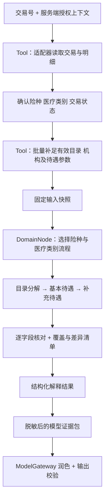

# Issue #78：按险种与医疗类别组织的结算费用分解设计

日期：2026-09-24（2026-10-12 修订，修订记录见 §17）  
状态：两链路已实现并以批量评估形态回放对账（普通门诊 81 笔、门特 mz 套表 14 笔）；生产默认关闭（`FEE_DECOMPOSITION_ROUNDING_MODE` + `FEE_DECOMPOSITION_HOSPITAL_CODE` 双门控），候选口径待签核（§16）  
首期：城镇职工基本医疗保险 × 普通门诊（已实现）；第二流程：城镇职工 × 门特（mz 套表，已实现，Issue #79 扩展）  
业务归属：`explain + settlement`

## 1. 设计结论

输入一个交易单号，系统自动读取结算事实、费用明细及相关目录和待遇依据，执行确定性费用分解；每次判断保留条件、实际值、命中结果、采用的规则和计算过程；最后逐字段与原结算金额核对，输出可供大模型表述的结构化解释证据。

采用两层组织：

- **险种＋医疗类别决定整体计算流程**：职工门诊、职工门特、居民门诊、居民门特分别有明确的流程函数。
- **费用分解模块复用**：目录范围、先行自付、起付线、分段支付、退休补助、军残、公疗、金额核对分别实现纯计算函数。共享模块不代表不同险种使用相同参数、适用条件或叠加次序。

首期只实现职工普通门诊；其他三种组合明确返回尚不支持，不套用职工门诊公式。退休补助、军残、公疗是首期需要覆盖的职工门诊分支；需求方已补充比例、顺序和日期依据（S9），字段映射、历史资格及分段归属仍须落地确认。

用户只需交易号，不代表内部只需要两张表。`o_Trade` 与 `o_FeeItem` 提供已发生事实，目录、机构、历史待遇参数补足“为什么”；账户和现金的具体分配，若缺少当时扣款规则或支付流水，只能说明实际支付构成。

**金额核对一致是解释成立的必要条件之一，不足以单独证明规则正确。** 禁止由目标金额反推比例、补差或选择恰好吻合的政策版本。

## 2. 依据与证据边界

| 编号 | 来源 | 本设计采用的内容 |
|---|---|---|
| S1 | [Issue #78：费用分解算法开发](https://github.com/ktyhwangfei/hospital_medical_insurance_agent/issues/78)，2026-09-24 读取正文，无评论 | 手工计算步骤、字段、关联表、候选公式、样本交易号 |
| S2 | 本次需求说明 | 交易号入口、解释已结算账单、可复用模块、分支记录、模型仅润色、先设计后开发 |
| S3 | `src/adapters/data_supply/settlement_record_queries.py` | 映射驱动、只读参数化查询、适配器边界；现有查询能力不能直接等同于本次完整数据契约 |
| S4 | `src/runtime/workflow/definitions.py`、`domain_nodes.py` | Tool 负责外部取数，DomainNode 负责确定性计算，OutputNode 明确输出来源 |
| S5 | `src/data_platform/outpatient_sync.py:_check_amounts`；`storage/postgresql/outpatient_store.py` | 已有交易/明细勾稽与字段映射；不能把同步质量检查当成完整费用成因解释 |
| S6 | `skills/settlement_explain_skill/calculator.py` | 已有计算器注册形态；当前存在浮点、缺值默认零、文本解析比例、默认退休系数，不适合作为本次可靠计算内核直接复用 |
| S7 | `docs/superpowers/specs/2026-08-26-mzsettlement-verify-skill-design.md` | 门诊单据解释范围、缺值不转零、明细口径待验证等既有设计 |
| S8 | `src/domain/AGENTS.md`；`docs/governance/TEST-VERIFICATION-MATRIX.md` | 领域语言、类型约束、验证要求 |
| S9 | 2026-09-24 本会话需求方补充的退休补充保险、残疾军人伤残补助、公费医疗补助结算规则 | 本设计 §7.5 的比例、计算顺序、资格条件、日期依据及住院边界；属于需求方提供的业务规则，正式文件出处待关联 |
| S10 | `docs/superpowers/specs/2026-09-29-issue78-批量评估决策与待确认.md`（决策记录 D1–D20） | 数据口径实证候选（码表映射、累计口径、资格派生、取整假定、行级口径）；全部为显式开关门控的候选口径，签核前不进生产默认路径 |
| S11 | `docs/superpowers/specs/2026-09-30-issue79-门特按项目付费-验证记录.md`；待遇参数表 CSV（门诊/门特各一） | 门特第二流程的黄金样本与参数唯一数值来源（EOP-*/ESP-* 规则 ID） |
| S12 | 2026-10-12 两链路批量对账复跑产物（`scripts/eval/issue78_fee_decomposition_batch_summary.json`、`issue79_special_mz_batch_summary.json`）与同日深度代码评审 | §17 的实现现状、评估锚点、无法对账数据归因与评审发现清单 |

以下是**软件设计建议**，不是新的医保政策裁定。S1 是业务需求及计算线索，不自动成为权威政策文件。S9 给出的业务比例直接进入设计，不再标记为未知；尚未查询真实数据库或验证样本金额，正式文件出处、适用时段、代码映射及未给出的参数仍须关联确认。S10 的 D1–D20 已由批量评估实证但同属候选口径，签核驳回即关闭对应开关/回落 UNKNOWN。

## 3. 范围与成功标准

### 3.1 首期目标

1. 在已授权院区内，交易号唯一定位一次职工门诊结算。
2. 按交易日期匹配目录，逐行分解总费用、医保内、医保外及自付二来源。
3. 记录人员身份、机构类别、年龄、起付线、支付档位和补充待遇的条件轨迹。
4. 独立重算已确认规则覆盖的金额，并与结算字段逐项对照。
5. 对不能重算的金额仍保留原始事实、可核对的关系及未解释原因。
6. 产出稳定、带版本、可回放的结构化结果；模型不可改变数字及结论等级。

### 3.2 本期不做

不执行正式结算、退费、冲正；不新增通用规则 DSL、动态插件平台或可视化流程编辑器；不开发其他三种组合；不修改政策知识治理门户；不自动猜测缺失政策。

## 4. 总体链路与现有架构接入



复用现有 Workflow 的节点模式，不把每个项目判断都变成 Workflow 节点。一个领域节点执行整笔分解，其内部产生细粒度轨迹。计算模块不查数据库、不调用模型。

建议增加一个“结算费用分解”Workflow，接入现有 `/policy-qa` 结算解释入口。Skill 可调用同一个领域服务，禁止另外维护一套公式。外层问答仍可接收 `question`，但算法输入不依赖问题文本；同一快照无论问哪个字段都得到同一计算结果。

当前 `settlement_data_provider.py:get_settlement_context` 面向住院语义对象，不能仅因同名 `settlement_id` 就用它读取门诊。`o_Trade.T_TradeNo`、医保端登记号 `djh`、医保结算 ID 必须保持显式映射，不能试查命中哪张表就认定是哪种单号。[来源：S3、S4及该文件]

## 5. 输入、数据契约与只读取数

### 5.1 公开输入

```json
{"settlement_id": "<o_Trade.T_TradeNo>"}
```

`hospital_code`、用户身份和读取权限来自服务端上下文，不能仅凭知道交易号就读取任意院区数据。险种、医疗类别、年龄、退休身份由数据决定，不要求用户填写，也不允许客户端覆盖。

### 5.2 需要的数据

| 数据组 | 主要来源/字段 | 用途与缺失处理 |
|---|---|---|
| 交易锚点 | `o_Trade.T_TradeNo`、`T_TradeDate`、状态及原交易关联字段 | 唯一性、时点、冲正识别；歧义时停止计算 |
| 分流 | `P_FundType`、`T_CureType` | 通过确认的码表转为标准险种/类别；未知不猜测 |
| 身份 | `PN_PersonType`、`P_Birthday`、特殊待遇资格字段 | 人员分支、结算时年龄；特殊资格字段需逐项确认，不按金额是否非零倒推 |
| 机构 | `T_HospCode → m_institution` 的机构键、`H_LEVEL` | 机构分支；Issue 未给连接键与历史版本，须确认 |
| 年度上下文 | `TB_FeeIn`、必要的年度基金累计/限额字段 | 起付、封顶；明确交易前/后、年度及累计范围 |
| 明细 | `T_TradeNo`、`ItemId/ItemNo` 候选行键、`ItemType`、`ItemCode`、`FeeType`、`UnitPrice`、`Count`、`Fee`、`FeeIn`、`FeeOut`、`SelfPay2` | 项目计算与观测值；行键及字段含义先验证 |
| 药品目录 | `yb_ypzdml.ypbm/sxrq/jzrq`、`sflb`、原自付比例、`a_ypbs/a_mzxj/a_zyxj/a_xbbl/ypfl/bzjg` | 目录分类、集采限价、自制剂；原自付比例实际列名待确认 |
| 非药品目录 | `yb_xzzlfwxm.xmbm/sxrq/jzrq/sfxmdj`、自付比例等 | 诊疗/材料分类；材料是否完整包含在本表中需确认 |
| 码表 | `yb_zdxm` 中 `flid='230'` 等已确认码表 | 解释药品分类，不代替金额规则 |
| 结算目标 | 下文 §10 的结算金额字段 | 仅作观测值/核对目标，不作为同一字段重算的输入 |
| 待遇参数 | 有效的起付线、支付比例、年龄档、封顶、补助资格/比例/基数/顺序 | 版本固定并有来源；缺项只阻断依赖它的分支 |
| 补充待遇历史 | 普通/预提退休标识、补充保险纳入日期、军残等级及资格有效期、公疗层级/统筹标识、在乡身份、本人定点机构关系 | 实际表列待映射；不以现时资格替代历史资格 |
| 日期与分段 | 真实结算日期、逐项费用发生日期、费用进入共付段及公疗门槛以上部分的分配依据 | 退休补助按结算日期、军残按费用发生日期；禁止混用或无依据分摊 |

物理字段名以适配器映射为准；Issue 中 `item_type/fee_type` 与源表 `ItemType/FeeType` 不直接混用。沿用现有数据供给连接和映射机制；首期可只读直查这些源表，不要求先完成全量语义治理。已有 PG 镜像只有在字段、历史目录和快照完整性满足同一契约时才可替换，不能混用不同时点的数据拼出“完整”结果。

### 5.3 一次读取的完整性

1. 参数化定位交易；按院区/数据源域检查唯一性。
2. 完整读取该交易全部明细，禁止分页截断后计算；重复行键报数据异常，不静默去重。
3. 按明细编码批量读取有效目录，避免每条明细一次 SQL。
4. 目录有效期条件放在关联条件或候选筛选中，保留未匹配的原明细。Issue 中 `LEFT JOIN` 后在 `WHERE` 过滤目录日期，会排除未命中的明细，不宜直接复制。
5. 同一明细命中 0 条目录记 `missing_catalog`；命中多条记 `ambiguous_catalog`。不能任取首条或重复展开费用。
6. 日期边界、空结束日期、日期与时间精度按源契约确认；不默认把空结束日期视为永久有效。
7. 在数据源支持时使用一致性只读事务；否则校验读取前后版本/更新时间，不能确认一致性则标记。记录读取时间、来源、行数、内容哈希及规则版本。

历史机构等级、目录或待遇资格缺少历史记录时，当前值不能冒充结算时值。年度累计优先取交易时快照；缺失时不能仅累加本院数据代替跨院累计。

## 6. 算法组织和模块接口

### 6.1 两级选择

顶层按标准 `(insurance_type, medical_category)` 精确选流程。已登记两个组合：`employee + outpatient`（普通门诊）与 `employee + outpatient_special`（门特，Issue #79 扩展，职工/居民 mz 套表消歧）。

> **门特业务定位澄清（2026-10-12，需求方明确）**：门特 = **门诊特殊病，是门诊待遇，患者就诊方式是门诊，不是住院**。本系统门特链路只覆盖门诊场景，不覆盖住院结算。「视同住院」仅是医保**结算口径**表述（起付按住院类结算周期、统筹分段按住院口径比例），不代表患者住院。§7.5.5 的住院边界仅约束 S9 公疗住院规则，不属本流程。

原始险种码的映射尚未在 S1 给出，不能仅用 `T_CureType=11` 推断职工险种；批量评估中 `P_FundType='3'`/`T_CureType='11'`/`yllb='12'` 的码值已经语义注册中心码表确认（ESP-CODE-001/002），作为评估链路的合法前置。

地区、政策生效日期、人员类别、机构类别是流程内参数选择维度；它们不会被简化成全平台固定比例。后续组合各自定义模块调用顺序和输入基数。

> **实现现状偏差（2026-10-12 评审确认）**：门特第二流程对下表共享纯计算模块（目录分解/起付/大额/补充链）**零复用**，1561 行内核内联重写，参数门控机械亦整体复制且已发生一处漂移（门特 `_gate` 多拦「实测待码表确认」状态）。真复用仅 reconciliation/result/domain/`apply_rounding`。设计纪律不变；第三个流程（居民门诊/门特）落地前必须先完成公式层与门控层提取，否则漂移面再翻一倍。

| 模块 | 主要输入 | 主要输出 | 复用边界 |
|---|---|---|---|
| 目录范围分解 | 明细、有效目录、目录规则 | 每行医保内外、先行自付子项、轨迹 | 药品/诊疗/材料共享结果结构，规则分别确认 |
| 起付线分解 | 合格基数、交易前累计、起付规则 | 本次起付承担、进入支付段金额 | 支持不同阈值与累计口径 |
| 基金分段支付 | 基数、累计、费率档、封顶规则 | 各段基金支付、个人承担、封顶承担 | 只复用分段运算，不复用未经确认的待遇 |
| 退休补充补助 | 退休资格、已确认基数、补助规则 | `T_BCPay` 候选计算值 | 每种流程明确参与条件与先后 |
| 军残补助 | 资格/等级、已确认基数、补助规则 | `T_JCPay` 候选计算值 | 不按退休身份或非零支付推断资格 |
| 公疗补充 | 公疗资格、已确认基数、补助规则 | `T_OfficalPay` 候选计算值 | 不默认覆盖全部剩余个人负担 |
| 汇总与核对 | 独立计算值、原始观测值、字段口径 | 字段级差异、覆盖、证据 | 各流程共享核对机制 |

模块输入为不可变业务值对象，输出包含 `amounts`、`branches`、`calculations`、`uncertainties` 和证据引用。简单纯函数加静态选择表即可，不引入只有一个实现的策略工厂。

公共代码复用的是**同一业务含义下的计算**。本期叠加顺序按 S9 明确为：大额支付 → 退休补助 → 军残补助 → 公疗补助。享受公疗的在乡残疾军人跳过军残补助。其他险种及类别不得自动继承这个顺序。

## 7. 职工门诊详细步骤

### 7.1 入口校验与身份判断

- 确认交易有效及属于支持组合。首期正向已结算单参与完整重算；冲正、退款、部分退费或负明细进入明确的未支持重算状态，返回可读事实与原因，不取绝对值套正向公式。
- S1 的在职候选代码：`11,12,40`。
- S1 的退休候选代码：`21,22,25,26,41,42,54,56,61,62,63,64,65,66,67,68,71,72,73,74,75,76,77,78,81,82,83,84,85,86,87,88,92,93,94,95,96,97,98,99`。
- 上述集合应有确认版本；其他代码为未知，不默认在职。退休不自动等于具有退休补助资格。
- S1 提出 `H_LEVEL=14` 为社区、`H_LEVEL<14` 为医院——**该假设已废弃（决策 D9）**：实测 14 为未评级，按未知处理。现以 `H_TYPE` 为主依据（院内字典 k80：04=社区卫生站、06=村卫生室），`H_TYPE` 缺失回落 `H_LEVEL` 候选；空串按缺失归一（适配层 strip 后归 None），空值、异常值及其他等级为未知。
- 退休年龄以交易日期与出生日期计算已满周岁，不以当前日期计算；年龄阈值、生日当日与闰日口径纳入参数和边界测试。

### 7.2 三大目录逐项分解

每行先保存账面 `Fee/FeeIn/FeeOut/SelfPay2`，独立计算值另存。`Fee` 与 `UnitPrice×Count` 分开校验，不能无条件替代：源端可能有折扣、单位换算或取整。

**药品：`ItemType=0`**

1. 按交易时点匹配药品目录，记录命中依据。
2. 按已确认的 `FeeType/sflb` 判断甲乙丙或其他类别；二者冲突时按确认的优先级处理，未确认则停在未知。
3. 普通目录药品按有效原自付比例计算；全自费类按确认规则全额归医保外。
4. 集采标识 `a_ypbs=1` 时比较同单位单价与门诊限价 `a_mzxj`。本流程不使用住院 `a_zyxj`。
5. S1 记录“超过限价：原自付比例＋超限价上浮比例”；原要求确认 `a_xbbl` 语义。**已按候选口径编码（决策 D19）**：按**最终自付比例**（明细行 `MEDIC_L` 优先、否则目录 `a_xbbl`）作用于整项费用划分自付二，与 docx「原自付+上浮」最终比例语义一致（实证 n=2）；结果附 `NCP_EXCESS_RULE_CANDIDATE` 不确定性，签核驳回即回落 `NCP_EXCESS_RATIO_SEMANTICS_UNCONFIRMED` 停未知。未通过一致性评价药品（EOP-NCP-002 生效日期未明确）仍恒 unknown。
6. `ypfl∈{16,6}` 自制剂候选规则：单价 `≤bzjg` 方可按目录待遇纳入，`>bzjg` 整项自费。[来源：S1] `ypfl` 代码含义及与集采规则重叠时的优先次序须确认；不能把“超过则全自费”改成“只超价部分自费”。

**非药品：`ItemType≠0` 且该值有效**

1. 匹配 `yb_xzzlfwxm` 等经确认的诊疗/材料目录。
2. `sfxmdj=1` 无自付、`2` 有自付、`3` 全自付为 S1 的候选规则；`2` 仍须取得实际比例及基数。
3. `sfxmdj` 为空必须返回未知。S1 的“空无自付（猜测）”不得进入正式算法。
4. 材料限价、限用条件与单位换算无依据时，保留未解释金额；不得以“非药品”标签宣称已完整支持所有材料。

**互斥金额与非互斥标签分开**：每笔原始费用只分配一次到最终金额桶；“乙类”“集采”“超限价”可同时作为解释标签，但不能把三个标签金额再次求和当作总费用。

自付二与 `FeeOut` 是否重叠，以及 `FeeIn` 是扣先自付前还是后的口径，必须用数据字典和样本确认。内部记录 `self_pay_2` 作为可追踪子项，不预先认定它是 `FeeIn+FeeOut` 之外的第三项，防止重复计入个人负担。

**行级口径候选决策（S10，已编码、评估链路验证，签核前附候选不确定性）**：

- **D14**：有自付项目的先行自付**不进报销基数**（`FeeIn = Fee − 自付二`）且计入医保外；诊疗单价限额超出部分同口径入自付二（账面口径实证）。
- **D17**：非集采门诊限价——明细行 `SP_SCALE>0`（结算事实）优先于目录 `A_mzxj>0`；限内按比例、**超限部分全自担**（实证 n=1）。
- **D18**：明细行 `MEDIC_L>0` 为实际先行自付比例的结算事实，**优先于目录 `zfbl`**；`MEDIC_L=0` 视为未维护回落目录（实证 55/55 行）。
- **D20**：全自付行（其它类/自付比例=1）先定自付档、整行个人承担，**不再评估**自制剂/集采分支。
- **D1/D2**：`ItemType` 按院内字典 k10 分流（0=药品、1/2=诊疗、3=材料，未覆盖取值不猜测）；收费类别按字典 flid=230 自付档分组，目录 `sflb` 与账面 `FeeType` 冲突判定在分组层面（同组不同码不冲突，跨组停未知）。
- 另注（2026-10-12 评审）：`ItemType≠0` 行级分解已按 D1 落地，不再是「非药品统一停未知」；比例值域（>1 脏数据）当前无护栏，列入 §16 新增待确认项。

### 7.3 起付线

定义 `E` 为本次确认口径下的合格费用基数，`A` 为同年度交易前同口径累计，`D` 为适用起付标准。

若政策确认起付按该费用累计计算，则建议公式：

```text
本次起付承担 F = min(E, max(D - A, 0))
进入后续支付段 B = E - F
```

上述是待确认口径下的参数化公式，不是已确认的本地政策。`TB_FeeIn` 只有在证明是交易前累计后才能作为 `A`。若是交易后累计，必须有可靠本次增量才能还原，不能盲目减 `T_FeeIn`。累计含本次与否、年度重置、负值异常均保留判断轨迹。

**累计口径实证（决策 D3/D4/D16，S10）**：探针实证 `TB_Year`=交易年时账面 `TB_FeeIn`/`TB_BigPay` 即同人同年**交易前**口径累计（D3/D4）；`TB_Year≠交易年`（实测全为 2000 未维护）时按同人同险种同自然年**本院**历史推导下界（遇锚点交易 floor 抬升，D16），附 `ACCUMULATION_DERIVED_IN_HOSPITAL`。上述均由 `accumulation_caliber_confirmed` 开关门控，默认关闭，签核前仅评估链路开启。另注（2026-10-12 评审）：负累计值当前无防护分支（会放大起付/突破封顶/虚增公疗 G），D16 推导 SQL 缺院区过滤，均列入 §16 新增待确认项。

`T_FirstPay` 为核对目标，不用于反推出 `D` 或覆盖计算的 `F`。

### 7.4 门诊大额支付与大额个人承担

由确认的身份、机构、年龄、政策时点选支付规则，规则可能单段或多段。不能通过 `T_BigPay/B` 反求适用比例。

在无封顶且规则确认只含一个支付段时：

```text
大额支付 = 按确认取整规则(B × 基金支付比例 r)
大额个人承担 = B - 大额支付
```

存在跨档时，对本次费用与各年度区间的交集分别计算：`segment_amount=max(0,min(A+E,upper)-max(A,lower))`。只有 `A/E/upper/lower` 口径一致时该公式可用；起付段已排除则不得再次扣起付。

基金封顶与费用封顶分开：基金限额使用历史基金已支付累计，不能拿费用累计替代。封顶以上个人承担是否进入 `T_BigSelfPay` 或独立 `T_BeyondBig`，须先确认字段口径，再汇总；不把差额自动归入大额自付。

**2023-01-01 起超 2 万元段的实现公式（已编码，补记入设计）**：分段边界是基金年度累计支付口径（2 万，EOP-RATE-301/302），费用口径换算为 `b1 = min(B, (20000 − prior_fund) / rate)`——该换算仅在段内基础比例恒定时成立；边界归属无 off-by-one（prior_fund 恰好 20000 时 b1=0，边界归超档段，符合「达 2 万元后」语义）。2022-12-31 前为 2 万元基金支付封顶制（EOP-CAP-001，`min(B×rate, cap − 基金累计)`）。另注（2026-10-12 评审）：封顶触发时封顶以上费用目前混入 S 直接流入补充待遇链，与 §7.5.1 的 S 定义冲突，列入 §16 新增待确认项。

### 7.5 退休补充、军残、公疗

本节比例与先后顺序来源于 S9。各模块统一执行：

```text
检查资格 → 检查规则时点 → 确定不重叠的计算基数
→ 应用比例/限额 → 记录支付与基数去向 → 核对对应结算字段
```

- 资格确定不满足：`not_applicable`；如果结算已有非零支付，另报资格与账面冲突。
- 资格未知：`unknown`，不得当作不享受。
- 资格满足但必需数据或规则参数缺失：保留原始金额，`observed_only`；下游独立重算若依赖该金额则阻断。
- 账面金额为零只证明实际未支付，不证明没有资格、未达条件或比例为零。

> **三值纪律澄清（2026-10-12 评审）**：「资格未知 → unknown」适用于**人员身份未知**与**身份内细分维度未知**的一切情形——人员类别未知（`PersonKind.UNKNOWN`）时退休补助同样必须 unknown（当前实现塌陷为 not_applicable，已识别缺陷，列入 §16）；公疗分支的在乡残疾军人身份未知时不得静默落到一般退休/在职分支（95%/90%），同理军残模块对同情形已正确拦截。资格不适用但账面非零的冲突信号必须透出到用户文案（当前公开模板只说「本单不适用」，冲突在文本层消失，列入 §16）。

#### 7.5.1 统一基数与计算顺序

定义 `S` 为**门诊大额共付段**个人自付金额，`R` 为退休补助，`J` 为军残补助，`O` 为公疗补助。`S` 不包含起付线以下、医保外以及未经确认纳入共付段的封顶以上费用；只有确认 `T_BigSelfPay` 与该基数完全一致时，才建立对应映射。重算使用计算得到的 `S`，账面 `T_BigSelfPay` 仍独立作为对照。

```text
大额共付段自付 S
  → 退休补助 R
  → 剩余共付段自付 S - R
  → 军残补助 J（公疗在乡残疾军人明确跳过）
  → 公疗补助 O（按医保内累计超过 1300 元的适用部分补足目标待遇）
```

公疗基数和大额共付段不一定相同：1300 元是 S9 的公疗待遇累计门槛，不得据此替换基本医保起付标准。必须保留分段金额及各基金在该段的支付归属，不能直接对整笔剩余自付乘 95% 或 90%。

#### 7.5.2 退休补充保险补助

| 退休类别 | 计算基数 | 补助比例 | 计算值 |
|---|---|---|---|
| 普通退休人员 | 门诊大额共付段个人自付 `S` | 50% | `R = round_policy(S × 0.50)` |
| 原社会化退休人员（预提退休人员） | 同上 | 60% | `R = round_policy(S × 0.60)` |

`round_policy` 表示已确认的取整规则，具体模式和逐段/汇总取整尚待确认。

开始纳入补充保险的资格时点以**就诊交费的结算日期**判断，不按费用发生日期，也不按查询当天判断。[来源：S9]

需要取得：普通/预提退休类别、纳入补充保险起始日期、真实结算日期及适用规则版本。候选 `T_TradeDate` 是否就是所需结算日期必须核实；不能仅凭名称确定。日期等于起始日期按“起始日纳入”的设计解释处理，实施前用起始日前/当日样本确认；若源业务约定不同则显式版本化。

退休身份已知但普通/预提类别未知时不默认 50%；补充保险开始日期缺失时不默认已纳入。

#### 7.5.3 残疾军人伤残补助

| 身份 | 伤残等级 | 计算基数 | 比例 | 计算值 |
|---|---|---|---|---|
| 在职 | 5–6 级 | `S` | 70% | `J = round_policy(S × 0.70)` |
| 在职 | 1–4 级 | `S` | 100% | `J = S` |
| 退休 | 5–6 级 | `S - R` | 50% | `J = round_policy((S - R) × 0.50)` |
| 退休 | 1–4 级 | `S - R` | 100% | `J = S - R` |

退休军残必须依赖退休补助的独立计算结果；`R` 未知时不得用零代替。退休补助明确不适用时 `R=0` 可以继续，但必须保留不适用依据。

是否可分解军残补充，以**普通门急诊费用发生日期**确定。[来源：S9] 因而快照必须区分结算日期与明细费用发生日期。跨资格生效日的交易按明细发生日期分组，只有资格适用组参与该补助；不能以较晚的结算日期覆盖所有明细。

这要求把大额共付段自付及退休补助保留到对应费用分组。若源数据/业务规则无法确定跨日费用在起付段、共付段的分配顺序，则该笔军残金额标记不可独立核验，不能自行按金额比例摊分。费用发生日期字段、资格历史记录及组内取整顺序是待确认的数据契约。

享受公疗的在乡残疾军人不执行本模块，记录 `not_applicable`，原因 `RURAL_DISABLED_VETERAN_PUBLIC_MEDICAL_EXCLUSION`，转到 §7.5.4 的公疗 100% 分支。该排除条件优先于军残等级计算；资格未知且会改变路径时，不默认执行军残。

S9 提及普通门急诊，首期只上线已定义的普通门诊组合；急诊原始代码及与普通门诊的同流程映射确认前不自动扩展路由。

#### 7.5.4 单位补充险（原公疗）补助

资格前提：参加基本医疗保险的市级公费医疗人员，或参加市级统筹的区级公费医疗人员，且费用发生在**本人定点医疗机构**。本人定点资格与“医院是否医保定点机构”不同，需取得对应人员的有效定点关系。[来源：S9]

| 分支 | 已明确的前置支付顺序 | 医保内年度累计超过 1300 元部分的最终基金目标比例 |
|---|---|---|
| 一般公疗退休人员 | 大额 → 退休补助 → 军残补助 → 公疗 | 95%，个人承担 5% |
| 一般公疗在职人员 | 大额 → 退休补助（不适用则跳过）→ 军残补助 → 公疗 | 90%，个人承担 10% |
| 享受公疗的在乡残疾军人 | 大额 → 退休补助 → 公疗；不再结算军残补助 | 100%，个人承担 0%；累计 1300 元（含）以下不支付公疗补助 |

令 `A_in` 为交易前同年度医保内费用累计，`E_in` 为本次同口径医保内费用。对正向交易，落在公疗门槛以上的本次费用为：

```text
G = max(A_in + E_in - 1300, 0) - max(A_in - 1300, 0)
```

`G` 还须具备本分支资格及本人定点条件。若交易内资格混合，不得先筛掉不适用费用后重算累计位置；先按确认规则确定年度区间，再取符合资格的交集。`A_in` 与 §7.3 的 `A` 只有在口径确认相同时才可复用。

以下是根据 S9“包含公疗后达到目标比例”推导的**待黄金样本验证的实现公式**：

```text
q = 0.95 / 0.90 / 1.00（按分支选择）
target_fund_G = round_policy(G × q)
prior_fund_G = 大额、退休补助、军残补助在 G 对应费用段上已计算的支付合计
O = target_fund_G - prior_fund_G
```

在乡残疾军人分支中，`prior_fund_G` 不含军残支付。不能把整笔 `T_BigPay/T_BCPay/T_JCPay` 不分段直接从 `G×q` 中扣除，也不能用实际 `T_OfficalPay` 反求补助金额。

`O` 在 `[0, G-prior_fund_G]` 内才是正常补足结果。若已有基金支付超过目标，保留冲突与负差额诊断，不输出负补助，也不擅自冲减已有基金；“超过目标时补助归零、维持更高待遇”等处理需另有确认规则。一般公疗人员累计 1300 元以下的具体处理，S9 未像在乡分支一样明示，先列为待确认，不推定另有补助。

1300 元不等于“整笔个人支付保留 1300 元”。例如仅用于解释区间的算术例：交易前累计 1200、本次医保内 300，则门槛以上部分 `G=200`；基金目标应用于这 200 元，不能应用于全部 300 元。

#### 7.5.5 补助链算术示例与住院边界

以下只验证补助公式组合，假设日期、资格均满足，未涉及公疗：

| 示例 | 共付段自付 S | 退休补助 R | 军残补助 J | 补助后该段剩余个人自付 |
|---|---:|---:|---:|---:|
| 普通退休、5–6 级军残 | 100.00 | 50.00 | 25.00 | 25.00 |
| 预提退休、5–6 级军残 | 100.00 | 60.00 | 20.00 | 20.00 |
| 普通退休、1–4 级军残 | 100.00 | 50.00 | 50.00 | 0.00 |
| 在职、5–6 级军残 | 100.00 | 0.00（不适用） | 70.00 | 30.00 |

享受公疗的在乡残疾军人不套上述军残示例，按公疗分支补足适用段到 100%。

S9 同时给出住院规则：公疗人员跨年度或跨周期住院，先按基本医保政策结算，再**以交易为单位**计算公疗补充支付。本次将其记录为后续住院流程约束，不应用门诊 1300 元门槛或 90%/95% 比例推算住院，也不把多笔住院交易合并后统一补助。

### 7.6 最终汇总

汇总模块使用可追溯的计算结果，不从原结算目标补缺以伪装完整重算。可以另做“用观测金额验证等式”的账面核对，但它必须显式标注 `identity_check`。

## 8. 分支与计算轨迹

每个执行到的条件使用三值逻辑：`true / false / unknown`。父分支未进入时子分支为 `not_evaluated` 并注明原因，不能记为 `false`。上游缺失为 `blocked`，规则不适用为 `not_applicable`，两者区分。

| 轨迹字段 | 含义 |
|---|---|
| `step_id / parent_step_id / module_id` | 稳定步骤标识及层次 |
| `scope_ref` | 交易或具体明细行的引用 |
| `condition` | 条件代码、中文含义、比较操作及左右值 |
| `outcome / reason_code` | 判断结果及原因 |
| `input_refs / rule_refs` | 数据字段/目录记录/规则版本引用 |
| `calculation_refs` | 命中后产生的计算步骤 |

计算记录另外保留 `formula_id`、公式版本、操作数的引用和值、未取整结果、取整规则及最终金额。前端可展示算式文本，但文本不是运行时可执行表达式，不使用 `eval`。

例如在职人员：退休条件记录 `false`；退休年龄档判断记录 `not_evaluated`，原因是退休前提不满足。目录缺失时集采判断记录 `unknown` 或依赖阻断，不能写“非集采药”。

## 9. 精度、版本和回放

- 金额、比例、数量使用 `Decimal`；从数据库 Decimal 或十进制字符串构造，不经过 float。
- 金额对外统一十进制字符串，例如 `"123.45"`；比例例如 `"0.80"`；币种 CNY。
- 按确认规则明确逐行取整、逐段取整和最终汇总取整；取整模式必须有版本，不凭习惯默认某种模式再视为准确。
- 正式吻合按确认精度判断；例如到分结算，建议 `difference == 0.00` 才为 `matched`。一分钱差异也保留，不自动抹平；确有政策认可的容差时另列 `within_tolerance`，不得改写差额。
- 固定 `algorithm_version`、规则/目录版本、字段映射版本、输入快照哈希及读取时间。业务结果在相同输入下确定；运行 ID、时间可不同。
- 回放依赖实际保存的最小必要快照，哈希本身不能用于回放。首期复用现有轨迹存储与授权策略；若容量不足才新增专用持久化，不建立第二套审计平台。
- 规则来源区分 `issue_note / approved_business_rule / policy_document / source_catalog`。实验性规则即使吻合，也不能升级为已确认政策解释。

## 10. 逐字段解释与核对矩阵

所有目标字段都生成结果项，包括零值和缺失值。字段之间有包含关系，表中金额不能纵向求和。

> **结果条目口径（2026-10-12 修订）**：本表 15 个目标字段；实现另产出 5 条派生对照行（`T_FeeAll.identity`、`T_FeeIn.detail`、`T_FeeOut.detail`、`T_SelfPay2.detail`、`T_SelfPayAll.vs_fee_all_minus_fund`），故正常路径字段结果共 **20 个条目**，`coverage.target_field_count` 按 20 计。「所有目标字段都生成结果项」对**任何分支路径**均成立——D15 全额自费路径当前缺 `T_FundPay` 行（已识别缺陷，列入 §16）。

| 目标 | 独立解释/计算路径 | 账面核对及注意事项 |
|---|---|---|
| `T_FeeAll` 总费用 | 有效原始明细 `ΣFee` | 对照 `T_FeeIn+T_FeeOut`；不由总费用倒推明细 |
| `T_FeeIn` 医保内 | `Σ` 独立目录分解医保内 | 同时核对 `ΣFeeIn`，显示目录计算、明细账面、交易账面三层差异 |
| `T_FeeOut` 医保外 | `Σ` 独立目录分解医保外 | 同上；自付二归属未确认则不宣称完成 |
| `T_SelfPay2` 自付二 | 独立计算各行先行自付 | S1：`Σo_FeeItem.SelfPay2`；只求原始字段和属于明细汇总核对 |
| `T_FirstPay` 本次起付承担 | §7.3 | 缺累计/阈值则无法独立计算 |
| `T_BigPay` 大额支付 | §7.4 | 比例、机构、年龄、封顶证据齐全 |
| `T_BigSelfPay` 大额个人自付 | §7.4 中已确认范围的个人承担 | 核实是否含封顶以上，不自动包揽差额 |
| `T_BCPay` 退休补充补助 | §7.5.2：共付段自付的 50%/60% | 区分普通/预提退休，以结算日期判断纳入资格 |
| `T_JCPay` 军残支付 | §7.5.3：身份、等级及剩余基数 | 退休先扣退休补助；按费用发生日期判断资格；公疗在乡军残排除 |
| `T_OfficalPay` 公疗补充支付 | §7.5 | S1 自付一公式旁误标“大额基金”，这里保留物理字段名并待确认中文口径 |
| `T_SelfPay1` 自付一 | S1 候选：`T_FeeIn-T_BigPay-T_OfficalPay` | 需确认不扣退休/军残补助的原因；不等同于最终个人应付 |
| `T_FundPay` 基金合计 | S1 候选：`BigPay+BCPay+JCPay+OfficalPay` | 必须检查本单是否另有基金渠道，遗漏非零渠道则候选公式不适用 |
| `T_SelfPayAll` 最终个人承担 | S1 候选：`FirstPay+FeeOut+BigSelfPay-BCPay-JCPay-OfficalPay` | 再与 `FeeAll-FundPay` 独立核对；先核实先行自付与封顶归属 |
| `T_PersonCountPay` 账户支付 | 有当时余额、资格及扣款规则时可重放 | 否则仅报告账面渠道金额，不反推支付意愿 |
| `T_CashPay` 现金支付 | 有实际支付规则/流水时解释分配原因 | `SelfPayAll=PersonCountPay+CashPay` 只证明渠道加总一致 |

核对类型固定区分：

1. `independent_recalculation`：费用事实＋规则独立计算，对照目标金额。
2. `detail_aggregation`：明细已记金额汇总，对照交易汇总。
3. `identity_check`：原始账面字段之间满足等式，不证明各字段原因。

不得把同一目标字段经由上游原始目标绕一圈算回自身。每项记录依赖图；例如退休补助只读了账面金额，下游最终个人承担即使吻合，也只能是混合事实核对，不能标独立重算成功。

核对结果：`matched / mismatched / not_verifiable / not_applicable`。`difference` 统一为 `calculated - observed`。未知目标值不是零；完整性不足的明细合计不得作为完整合计。

总体另设两条状态轴：`execution_status=complete/partial/unavailable` 与 `reconciliation_status=matched/mismatched/not_verifiable`。发现不一致不代表程序失败；“全部流程执行完但存在差异”合法。业务公开结果只有必需字段证据完整、独立重算通过、关键分支无未知时才可声明完整解释，否则保留部分解释和差异。

> **口径澄清（2026-10-12 修订）**：`complete` 的实现定义是「目录分解完整且无任何 unknown/blocked **分支**」——identity_check 字段（`T_SelfPay1`/`T_FundPay`/`T_SelfPayAll`）与支付渠道字段（恒 `PAYMENT_CHANNEL_REPLAY_UNAVAILABLE`）在 complete 结果里仍可为 not_verifiable。对外能否宣称完整解释由 `answer_constraints.may_claim_full_explanation` 单独门控（要求 `execution_status=complete` 且 `reconciliation_status=matched`），且应再排除「含未确认候选规则不确定性」的情形（D15 路径当前硬编码 complete，列入 §16）。`explanation_level` 当前封顶 `amount_reconciled`，全系统不产出 `causally_explained`（保守取向，待签核后开放）；§9 的「币种 CNY」未落入契约（无 currency 字段），维持十进制字符串金额约定，若未来多币种再补字段。

## 11. 面向模型的规范结果

建议结果名 `SettlementDecompositionResult`，对外 Pydantic 契约；新增领域术语在实施时登记通用语言字典。以下为结构示例，数字仅为演示，不是 Issue 样本实算。

```json
{
  "schema_version": "1.0",
  "algorithm_version": "employee_outpatient_v1",
  "settlement_ref": "settlement:example",
  "profile": {"insurance_type": "employee", "medical_category": "outpatient"},
  "execution_status": "partial",
  "reconciliation_status": "not_verifiable",
  "fields": [
    {
      "field_code": "T_FeeAll",
      "label": "总费用",
      "observed_amount": "100.00",
      "calculated_amount": "100.00",
      "difference": "0.00",
      "check_type": "detail_aggregation",
      "check_status": "matched",
      "explanation_level": "amount_reconciled",
      "calculation_refs": ["calc.total"],
      "citation_refs": ["fact.trade.total", "fact.items.total"]
    },
    {
      "field_code": "T_BCPay",
      "label": "退休补充保险补助",
      "observed_amount": "8.00",
      "calculated_amount": null,
      "difference": null,
      "check_type": "independent_recalculation",
      "check_status": "not_verifiable",
      "explanation_level": "observed_only",
      "calculation_refs": [],
      "citation_refs": ["fact.trade.bc"],
      "uncertainty_refs": ["u.bc.rule"]
    }
  ],
  "branches": [
    {
      "step_id": "eligibility.retired",
      "module_id": "person_classification",
      "condition": {"operator": "in", "actual_value": "21", "expected_ref": "rule.retired_codes"},
      "outcome": "true",
      "input_refs": ["fact.trade.person_type"],
      "rule_refs": ["rule.retired_codes"]
    }
  ],
  "calculations": [
    {"calculation_id": "calc.total", "formula_id": "sum_item_fee_v1", "input_refs": ["fact.items.total"], "result": "100.00", "rounding": "source_amounts_unchanged"}
  ],
  "citations": [
    {"id": "fact.trade.total", "kind": "settlement_fact", "ref": "snapshot:example/trade/T_FeeAll", "value": "100.00"},
    {"id": "fact.items.total", "kind": "fee_facts", "ref": "snapshot:example/items/Fee", "values": ["40.00", "60.00"]},
    {"id": "fact.trade.bc", "kind": "settlement_fact", "ref": "snapshot:example/trade/T_BCPay", "value": "8.00"},
    {"id": "fact.trade.person_type", "kind": "settlement_fact", "ref": "snapshot:example/trade/PN_PersonType", "value": "21"},
    {"id": "rule.retired_codes", "kind": "issue_note", "ref": "https://github.com/ktyhwangfei/hospital_medical_insurance_agent/issues/78", "approval_status": "pending"}
  ],
  "uncertainties": [
    {"id": "u.bc.rule", "code": "MISSING_BENEFIT_ELIGIBILITY", "affected_fields": ["T_BCPay"], "message": "已知普通退休补助为50%、预提退休为60%，但本单缺少退休类别和补充保险纳入日期，尚不能确定适用分支。"}
  ],
  "coverage": {"target_field_count": 2, "independently_explained_count": 0, "amount_reconciled_count": 1, "observed_only_count": 1},
  "answer_constraints": {"may_claim_full_explanation": false, "may_infer_missing_rules": false}
}
```

实际结果包含 §10 全部目标；示例只展示两项。解释等级使用 `causally_explained / amount_reconciled / observed_only / unexplained`，分别代表完整因果证据、仅金额关系吻合、仅原始观测、无法解释。未经确认的 Issue 规则不计入 `causally_explained`。

内部审计结果保留完整明细及字段定位；模型证据包默认只包含问题相关字段、依赖计算和必要分支摘要。大单据完整明细另存授权轨迹，通过证据 ID 定位，避免把全表塞进提示词；摘要必须保留总行数、覆盖范围和被省略数量，不能因截断变成“全部解释”。

## 12. 模型输出边界与展示

模型通过 `ModelGateway` 接收已脱敏证据包，只负责语言组织：

- 已完整解释：表述原因、计算基数、比例、结果及对应依据。
- 仅勾稽吻合：说“明细合计与结算记录一致”，不能说“医保报销政策计算正确”。
- 存在差异：原样保留实际值、计算值、差额和最早发生差异的层级，不擅自判定医保系统错误。
- 存在缺项：明确缺哪个规则或数据、影响哪个金额。不能用通常比例补全。

优先让模型输出带 `field_refs/step_refs/citation_refs` 的解释段落，由程序渲染金额与算式，减少自由生成数字。校验引用存在、金额未变、部分状态未被夸大；校验失败或模型不可用时使用确定性模板输出，已计算结果不丢失。

> **校验强度现状（2026-10-12 评审）**：当前润色校验仅为「润色文本数字集合 ⊆ 模板数字集合」单方向判断，防不住四类形态：①删除数字（把「差额 -0.01 元」改写为「基本一致」，违反本条「差异原样保留」）；②归属错位（同一数字挪到别的字段）；③状态词篡改（「暂不能核对」→「已核对无误」不引入新数字即通过）；④负号丢失（数字正则不提取负号，差异方向翻转检测不到）。升级为正式要求：多重集合（Counter）下限校验（模板金额在润色中必须保留出现次数下限）＋负号入正则＋状态词（暂不能核对/暂不可用/存在差异/部分解释）在场校验。另：公开视图当前丢弃 `fields[].reason_code` 与 `uncertainties[].affected_fields`，「字段卡片：缺什么」需要的 uncertainty↔field 关联在公开侧断开，补入公开契约时需评估。

患者姓名、身份证、原始出生日期不进入模型；仅提供必要的结算时年龄或年龄档，交易标识使用授权引用。目录名称和政策文本视为数据，不作为模型指令。用户端呈现业务名称，物理表/列和 SQL 留在受权限控制的审计视图。

> **物理标识符泄漏现状（2026-10-12 评审）**：`fields[].field_code` 即物理列名（`T_FeeAll` 等）直进公开契约——本节与 §10/§11 的表述存在矛盾，当前实现跟随 §11；多条 uncertainty message 内嵌物理列名（`a_xbbl`/`MEDIC_L`/`T_BigSelfPay`/`jczhf` 等）经公开视图与 summary_text 进模型 prompt，routes 层消毒清单未覆盖。裁决方向：公开契约的 field_code 改用稳定业务代码（物理名留在内部审计结果），内核 uncertainty message 改业务措辞；过渡期内 routes 消毒标识符清单须随新列名同步。

建议展示三层：总览（基金/个人与核对状态）→ 字段卡片（如何算、差多少、缺什么）→ 条件轨迹（为什么进入或跳过分支）。账户与现金在“支付方式”区，起付/自费/比例承担在“费用责任”区，避免相加两次。

## 13. 最小实现落点与兼容

以下为实际落点（2026-10-12 修订，均已实现）：

| 位置 | 职责 |
|---|---|
| `src/domain/insurance/fee_decomposition.py` | 输入快照、条件轨迹、计算记录等不可变业务值对象与枚举（三值逻辑、RoundingMode 等） |
| `src/runtime/policy_qa/fee_decomposition/` | 结果契约（result.py）、编排（employee_outpatient.py / employee_outpatient_special.py）、共享纯计算（catalog_split/deductible/big_pay/supplements/reconciliation）、参数门控（params_employee_outpatient[_special].py）、快照服务（snapshot_service[_special[_mz]].py）、公开视图（public_view.py）、门控接入（integration.py） |
| `src/adapters/data_supply/` | `outpatient_decomposition_queries.py`（门诊，全映射渲染）+ `record_query_mappings.py`；`outpatient_special[_mz]_queries.py`（门特，物理表/列硬编码——已知偏差，映射版本固定缺失，见 §16 新增项） |
| `src/runtime/api/policy_qa_routes.py`、`src/runtime/policy_qa/public_contract.py` | 门诊/门特预取分支 + `FeeDecompositionPublic` 白名单契约（`extra="forbid"`） |
| `src/tests/unit/runtime/policy_qa/fee_decomposition/` 等 | 单元 225 用例全绿（2026-10-12）；黄金样本回归（门特 mz） |

注：未走 `src/runtime/workflow/` 注册——实际经 policy-qa 预取分支接入（integration 门控），Workflow 接入仍是未来选项。

首期不需要独立公开 REST API：复用现有问答入口与内部强类型服务。外层仍遵循 `AgentResponse` 和既有 SSE `result/done` 契约；新增结果结构采用明确版本，不改变旧字段含义。未来若有独立核验客户端，再增加薄 API。

上线按 Workflow 已有启停能力控制。回滚关闭新分解流程；既有解释若不具备等价重算能力，必须仍标明其能力边界，不能退回默认比例计算后显示完整解释。代码及 Skill 制品变动按既有版本治理同步升级。

## 14. 验证与验收计划

验证按 **单元 → API → Flow** 串行执行；涉及领域模型按 R4 要求提供设计及兼容性说明。[来源：S8] 下表「覆盖现状」列为 2026-10-12 深度评审结论（单测 225 用例全绿），❌/⚠️ 项为签核或上线前必须补齐的验证缺口。

| 层级 | 必验场景 | 覆盖现状（2026-10-12 评审，单测 225 全绿） |
|---|---|---|
| 单元：目录 | 药品/非药品、甲乙丙、目录无命中/多命中、生效/失效边界、空等级、字段冲突、材料缺规则 | ✅ 已覆盖（含空截止日期不默认永久有效） |
| 单元：限价 | 集采低于/等于/高于限价；自制剂等于/高于标准；单位不一致；特殊规则重叠；比例异常 | ⚠️ 比例异常（ratio>1 脏数据）代码护栏与测试双缺；「单位不一致停未知」无用例 |
| 单元：待遇 | 在职/退休/未知；生日边界；社区/医院/未知；起付线前/跨线/线上；跨费率段/封顶；补助适用/不适用/未知/顺序缺失 | ⚠️ 闰日生日无测试（代码有 AGE_LEAP_DAY 分支）；「恰好等于 20000」无定点用例；退休补助 person=UNKNOWN 无测试（对应 §16 新增缺陷项） |
| 单元：退休与军残 | 普通/预提退休 50%/60%；结算日位于纳入日前/当日/后；军残四种身份等级组合；退休军残先扣退休补助；发生日期与结算日期跨资格日；跨日分配依据缺失时阻断 | ⚠️ 军残缺「在职 1-4 级（J=S）」断言；资格期 eligible_to 到期边界无测试 |
| 单元：公疗 | 本人定点/非本人定点/未知；累计低于/等于/跨过/超过 1300；退休 95%/在职 90%/在乡军残 100%；在乡分支跳过军残；已有支付超过目标的冲突；禁止扣除适用段之外的基金支付 | ⚠️ 「恰好=1300」「交易前已超 1300」两形态无测试 |
| 单元：核对 | 零与缺失、每层一分钱差异、禁止反推、禁止自付二重复计入、未覆盖非零基金、部分明细缺失 | ⚠️ T_SelfPay2 字段级核对、T_FundPay 恒 not_verifiable 分支无显式断言 |
| 单元：数据边界 | 重复明细、负明细/冲正、跨年累计、读取中数据变化、历史目录缺失 | ❌ 跨年累计（SQL 年过滤）与读取中数据变化（§5.3-7 一致性读）均无测试；后者亦未实现 |
| API | 交易号输入、权限与院区、歧义/不存在、字符串金额、结果 Schema、引用完整、异常响应契约 | ⚠️ 权限与院区零覆盖（当前 hospital_code 来自 env 而非服务端授权上下文，多院区部署前必须接线）；歧义/不存在仅服务层单测 |
| Flow | 真实形态数据→适配器→算法→核对→模型/模板→SSE；partial 与差异不丢失；模型故障及越界生成降级 | ❌ 整行缺失（模型降级仅单测覆盖） |
| 真实黄金样本 | 业务确认每个目标金额、适用分支及规则，冻结脱敏快照并回放；不能只断言最终总额 | ⚠️ 门特 mz 黄金样本已逐字段断言（8 例）；普通门诊（首期主流程）无 pytest 黄金样本，81 笔批量评估在 scripts/eval 手工回放，扰动测试（验收 3）与回放比对（验收 6）缺失 |
| 开关路径 | D3/D4 `accumulation_caliber_confirmed=True` 服务层路径（TB_Year 锚点、D16 推导、账面累计三路注入） | ❌ 零测试——签核后 partial→complete 的主开关，最复杂的口径代码 |

S1 的候选样本：`011100030X241118000008`、`011100030X241126000017`、`011100030X240913000067`、`011100030X251113008202`、`011100030X260417003528`。它们目前只是定位线索，不代表已验证覆盖某分支。实施时按真实查询结果标注覆盖，并补足缺失边界样本。

验收要求：

1. 支持组合及关键分支均有已确认样本；不支持组合不会走错公式。
2. 每个目标字段都有结果项，每个独立计算值可追溯到事实、参数、规则和取整过程。
3. 黄金样本逐字段符合确认口径；人为改变一项输入时相应分支/差异正确变化。
4. 所有必需分支具备规则与数据时才能称完整解释；未完成特殊待遇不能靠样本恰好为零隐藏。
5. 模型关闭仍能提供金额和条件解释；模型开启不能改变确定性结果。
6. 同快照同版本回放结果一致；授权/脱敏、既有问答场景与 SSE 结束语义不回归。

## 15. 分步实施计划（仅在设计获同意后执行）

| 顺序 | 最小可验证交付 | 完成依据 | 状态（2026-10-12） |
|---|---|---|---|
| 1 | 交易号→完整事实快照→账面字段及明细核对 | 数据口径签核、样本可回放；清楚标注暂未独立解释 | ✅ 已实现（含读元数据 citation 与内容哈希） |
| 2 | 三大目录逐行分解 | 每行内外/自付二可追溯；集采、自制剂和目录异常有边界测试 | ✅ 已实现（含 D1/D2/D14/D17/D18/D19/D20 候选口径，签核前附候选不确定性） |
| 3 | 职工门诊起付＋大额支付 | 年度累计、身份/年龄/机构、费率及封顶分支核对通过 | ✅ 已实现（累计口径 D3/D4/D16 由开关门控，默认关闭） |
| 4 | 补充待遇及最终费用责任闭环 | 退休/军残/公疗有完整规则和样本，叠加次序确认 | ✅ 已实现（叠加链 S→R→J→O；资格字段默认未知不反推，派生口径 D6/D7/D8 开关门控） |
| 5 | Workflow/Skill 复用结果＋模型表述＋用户端解释 | API/Flow 全链路验证、脱敏与降级通过 | ⚠️ 部分：policy-qa 接入 + 确定性模板 + 模型润色降级已实现；Flow 端到端验证缺失（§14） |
| 6 | 第二流程：职工门特（mz 套表） | 手算黄金样例逐字段吻合 | ✅ 已实现（Issue #79；8 例黄金样本回归；三态周期上下文 + 坐标守卫） |

每步可独立验证，但第 1～3 步完成不等于整个职工门诊算法完成。特殊分支暂缺规则可以发布标记清楚的部分解释能力，不能以此代替首期完整验收。

后续每新增一种组合：先给该组合手工黄金案例与参数口径 → 确认可复用模块和差异 → 新增一个明确流程 → 复用同一结果/核对/模型契约。至少第二个流程实际需要时才提取额外公共逻辑。**第二流程（门特）落地时未提取公共逻辑，1561 行内核整体复制（§6.1 偏差记录）；第三个流程（居民门诊/门特）动工前必须先完成公式层与参数门控层提取。**

## 16. 评审时需要确认的业务口径

架构可先评审，以下是实施相应模块前必须补齐的清单，不要求现在一次回答全部。

| 优先级 | 待确认事项 | 不确认的影响 |
|---|---|---|
| P0 | `P_FundType` 的职工/居民代码、`T_CureType` 的普通门诊/门特代码及地区适用范围 | 不能安全选择算法 |
| P0 | `FeeIn/FeeOut/SelfPay2` 与汇总同名字段的包含关系、原始金额与单价数量口径 | 不能可靠分解目录和个人承担 |
| P0 | `TB_FeeIn` 是否交易前累计、年度范围、是否跨院累计；起付标准 | 不能重算起付金额 |
| P0 | 在职/退休、机构、年龄的实际费率及时间版本；封顶口径和字段归属 | 不能重算大额支付 |
| P0 | 集采 `a_xbbl` 是最终比例还是增量、作用基数、等于限价分支；与自制剂规则优先次序 | 特殊药品分解不能确定 |
| P0 | 普通/预提退休、军残等级/在乡身份、公疗类别及本人定点关系的实际字段与历史资格；补充保险纳入日期、结算日期和费用发生日期的映射 | S9 已明确比例和顺序，但缺少数据时不能判定本单分支 |
| P0 | 共付段与公疗超过 1300 元部分的费用/基金归属、跨日资格费用进入各段的顺序、逐段及汇总取整规则 | 不能用整笔基金支付替代适用段支付，也不能自行比例摊分 |
| P0 | 一般公疗 1300 元及以下部分的处理、已有待遇超过 90%/95% 目标的处理、公疗资格及本人定点关系的判定时点 | 不自行生成负补助或削减已享待遇；对应边界暂不能完整解释 |
| P0 | S1 自付一公式、基金渠道是否穷尽、自付全款公式对封顶/特殊渠道的适用范围 | 可能出现重复或遗漏金额 |
| P1 | 机构连接键及历史等级、非药品/材料目录覆盖、自付比例物理列、空目录日期/等级语义 | 对应分支保留未知 |
| P1 | 各步取整模式、对账精度；账户/现金分配规则与流水是否可查询 | 尾差与支付方式只能部分解释 |

本次已据 S9 补入退休 50%/60%、军残四类比例、退休先扣补充保险、公疗后算及在乡军残排除规则；不再把这些业务规则列作待提供。没有依据的分支明确保留未知，不通过调参数把结算数字凑平。

### 16.1 候选口径签核清单（S10 决策 D1–D20，承接上表）

上表 P0 事项中的「数据口径如何读」已由批量评估实证为候选口径（S10），签核即转正、驳回即关开关/回落 UNKNOWN。签核建议顺序（按阻断面）：① D3/D4/D5 累计口径组（partial→complete 前置，且服务层开启路径当前零测试，签核前须补测试网）；② D6/D7/D8 资格派生组；③ D10 取整（EOP-RND-001/ESP-RND-001，样本方向支持 HALF_UP 到分）；④ D14/D17/D18/D19/D20 行级口径组（注意：此组当前在生产路径常开、无开关，与 S10「驳回无需改代码」的承诺不符，签核前须补开关或修订承诺）；⑤ D1/D2/D9/D15/D16 码表与识别组（值域已落 `value_domains.yaml`，status=candidate）。

### 16.2 2026-10-12 深度评审新增项

以下为两链路实现经验中新发现的问题，按「缺陷修复 / 口径裁决 / 签核前置」分类，均不改变本设计既有纪律：

| 类别 | 事项 | 说明与去向 |
|---|---|---|
| 缺陷 | 退休补助对人员身份未知塌陷为 not_applicable | 违反 §7.5「资格未知→unknown」；`retire_supplement` 需拆分 UNKNOWN/EMPLOYED 分支并补测试（§14 待遇行） |
| 缺陷 | D15 全额自费路径缺 `T_FundPay` 字段项 | 违反 §10「所有目标字段都生成结果项」；且该路径硬编码 `execution_status="complete"`，与「未确认规则不升级」存在张力（§10 口径澄清） |
| 缺陷 | D17 限价路径计算记录伪造未取整值 | `unrounded_result` 恒等于 result，审计轨迹失真（§8） |
| 缺陷 | mz 周期推导缺列 None 当 0、`bnzqslj` 缺失默认 650、`bnmcjylsh` 前提不校验 | 削弱「confirmed」含金量；与 D3/D4 同组签核时一并裁决 |
| 口径裁决 | mz 资格映射（cjjrdj/gwydybz/cblb=61）无签核开关 | 普通门诊同类有 `derive_eligibility_from_codes` 默认关闭；mz 须补同型开关，否则 profile 放行即整体进生产 |
| 口径裁决 | 门特公疗缺「本人定点医疗机构」资格前提（§7.5.4）；门特军残缺费用发生日期资格期与在乡公疗军残排除分支 | 与 djh=675 无法对账案例直接相关（§17.3）；`select_public_medical_param("rural_disabled_veteran")` 当前为死参数 |
| 口径裁决 | 2022 封顶触发时封顶以上费用混入 S 流入补充链 | 违反 §7.5.1 的 S 定义；触发窗口真实存在（退休补充 2006 起与封顶制重叠 16 年） |
| 口径裁决 | 累计值负值防护、D16 推导院区过滤、`str(None)` 查询守卫 | 负累计会放大起付/突破封顶/虚增公疗 G；D16 混入他院交易则不再是下界 |
| 口径裁决 | §5.3-7 一致性读未实现也未标记 | 裸多 SELECT 拼快照；最低成本补「一致性未确认」标记位，完整方案单事务+隔离级 |
| 口径裁决 | 模型润色校验升级（§12）、公开契约 field_code 业务化（§12） | 模型输出边界与物理标识符泄漏的正式裁决 |
| 签核前置 | 比例值域护栏（ratio>1 停 unknown）、D17 缺 unit_price/count 守卫 | §14 限价行必验场景，代码+测试双缺 |
| 签核前置 | 门特 SQL 物理表/列硬编码、无映射版本指纹 | 多院区扩展前必须回落 RecordQueryMapping 渲染（§5.2） |
| 签核前置 | API 权限与院区接线（hospital_code 当前来自 env） | §5.1「不能仅凭交易号读取任意院区」在多院区部署前必须落地 |

## 17. 实现现状与评估锚点（2026-10-12 修订新增）

### 17.1 两链路批量对账结果（2026-10-12 复跑，只读评估口径）

评估口径声明：险种/类别由 SQL 按已确认码值筛定（合法前置）；取整显式 `HALF_UP`（D10 假定）；门诊累计口径 D3/D4/D16 与资格派生 D6/D7/D8 经显式开关开启；verdict 仅以**内核独立重算字段**为准，账面内部核对（detail_aggregation/identity_check/支付渠道）单列不计入。

| 链路 | 范围 | 结果 | 对账比例 |
|---|---|---|---|
| 职工×普通门诊 | `P_FundType='3'` × `T_CureType='11'`，81 笔 | 准确 78 / 不可用 3 | 全量 96.30%（78/81）；可判定 100%（78/78） |
| 职工×门特（mz 套表，按项目付费） | `FUND_TYPE=3` × `yllb='12'` × `fyfs='0'`，14 笔 | 准确 8 / 差异 1 / 无法核对 5 | 字段级可判定 99.32%（147/148）；全字段 87.5% |

门诊分支覆盖（81 笔）：起付非零 30、大额非零 26、退休补助 3、公疗 2、军残 0（无正向样本）、自付二 49、D15 无待遇码 26、冲正 3；明细 227 行（药品 115/诊疗 62/材料 50），含集采药交易 73、自制剂候选 1。测试条件 SQL 与取证 SQL 见 `scripts/eval/issue78_79_reconciliation_test_conditions.sql`。

### 17.2 无法对账数据归因总览

所有无法对账数据均已逐笔归因，**无一例指向计算规则错误**：

1. **设计内预期不支持（3 笔，门诊）**：冲正/负明细交易（`UNSUPPORTED_REVERSAL_OR_NEGATIVE`，EOP-REF-001/002 未确认，§7.1）。含 1 对被冲正原单+冲正单（±2.50 元）与 1 笔全 33 行负明细冲正单（-2637.00 元）。
2. **院端数据缺口（5 笔，门特）**：mz 套表 5 笔 2025 年起周期表未维护，周期上下文 unknown，统筹/大额字段不硬算。
3. **候选资格口径存疑（1 笔，门特 mz）**：djh=675，公疗候选资格（gwydybz=0=享受）算出补助 683.99 但账面未付——同资格组 609 实付 585.00 内核核对一致（公式正向验证通过），658/676/716 内核算 0 与账面一致；675 孤例需核查本人定点关系/码义签核/是否漏付（§16.2 门特公疗前提项直接相关）。

### 17.3 对「金额核对一致」原则的再确认

金额吻合不单独证明规则正确；须同时核验周期累计、资格与目录证据。

### 17.4 修订记录

| 日期 | 修订内容 |
|---|---|
| 2026-09-24 | 初稿（设计评审稿，未开发） |
| 2026-10-12 | 依据两链路实现与深度评审（S12）修订：状态与落点更新为已实现；§2 增 S10–S12；§6.1 登记门特第二组合并记录共享模块零复用偏差；§7.1 机构分类改 D9（H_TYPE 主依据）；§7.2 补 D1/D2/D14/D17/D18/D19/D20 候选口径；§7.3 补 D3/D4/D16 累计实证；§7.4 补超 2 万段 b1 换算实现公式；§7.5 补三值纪律澄清；§10 明确 20 结果条目口径；§10/§11 补 complete 定义与 explanation_level/currency 现状；§12 补润色校验强度与物理标识符泄漏现状；§14 验证矩阵补覆盖现状列；§15 实施计划标记完成状态并增门特第二流程；§16 增 16.1 签核清单与 16.2 评审新增项；新增 §17 实现现状与评估锚点。 |
| 2026-10-12（二） | 门特业务定位澄清（§6.1：门诊特殊病=门诊待遇，非住院）；新增 §18 输出结构目标形态——患者真实待遇画像（需求方明确：费用分解的目的不是重算一遍，而是通过分解算法标定患者真实待遇）。 |

## 18. 输出结构目标形态：患者真实待遇画像（2026-10-12，需求方明确）

### 18.1 定位：对账是手段，待遇识别是目的

费用分解的价值不是「用算法把结算重算一遍」，而是**通过分解算法标定当前患者的真实待遇情况**：这个患者是在职还是退休（普通/预提）、起付线在哪档、基金按什么比例付、有没有退休补充/军残/公疗、公疗目标比例是多少。回答「这笔账对不对」是中间过程；回答「这个人享受什么待遇」才是最终输出。

为什么这条路找到的待遇最准：

1. **账面比资格字段诚实**。两链路开发证实：源系统的资格字段普遍缺失/未维护/语义不明（退休类别、军残等级、公疗标志、在乡身份无一可靠）；而账面金额是医保系统**当时实际按什么待遇结算的事实记录**。从事实反标待遇，绕开了档案数据不可信的根本问题。
2. **假设空间封闭，检验标准苛刻**。待遇档位是政策枚举（在职/退休×机构×年龄档、50%/60%、70%/100%、90%/95%/100%…），不是连续参数。每档假设要求**全部相关字段**独立重算且分毫不差才成立——单笔多字段同时巧合吻合的概率可忽略，这是「基本没有啥错误」的统计学底气。
3. **多笔交叉收敛**。同人历史交易各自独立检验，待遇画像逐笔收敛：一笔偶合可能，笔笔吻合不可能凑。
4. **与 §1 禁止反推原则的边界**。§1 禁止的是「为了对上账而调参数凑数」的无约束反推；待遇识别是**封闭枚举空间上的假设检验**——假设先验列出（已登记政策档位）、判定证据后置标注（哪些字段吻合支撑）、允许并如实输出「全部未知」。吻合的语义是「证据支持该患者享受此档待遇」，不是「证明政策如此」。

### 18.2 输出结构（在现有 `SettlementDecompositionResult` 之上增加待遇画像层）

```text
PatientBenefitProfile  患者真实待遇画像
├── profile_meta          algorithm_version、settlement_ref、结算日期、证据快照引用（哈希）
├── insurance_medical     险种、医疗类别（证据：码表确认 + profile 门控）
├── person_identity       人员待遇身份
│   ├── employment        在职 / 退休·普通 / 退休·预提(社会化) / 未知
│   │     └── evidence    T_BCPay 独立重算吻合档位、PN_PersonType 候选码、D8 派生（如有）
│   ├── age_band          结算时周岁 / 年龄段（<70 / ≥70，以交易日期计）
│   ├── military          军残等级组（1-4 / 5-6）、资格期、在乡身份
│   └── public_medical    公疗类别（市级 / 区统筹）、本人定点关系
├── benefit_parameters    识别出的适用待遇参数（每项附证据强度）
│   ├── deductible        起付标准 D、交易前累计 A、本次承担 F
│   ├── payment_tiers     机构类别 × 年龄档 → 基金支付比例、分段位置、封顶与已用额度
│   ├── retire_supplement 资格、比例（50%/60%）、补充保险纳入日期
│   ├── military_supplement 比例（70%/100%/50%）、基数（S 或 S−R）
│   └── public_medical    目标比例（90%/95%/100%）、1300 门槛与本次 G 段位置
├── evidence_strength     每项结论三态证据强度（沿用内核三值纪律）
│   ├── confirmed_by_settlement  本笔（及同人历史笔）独立重算全字段吻合
│   ├── candidate                候选口径或单笔吻合，样本不足
│   └── unknown                  数据缺失无法判定（附缺什么、影响哪项）
├── disputes              待遇争议清单：算法标定待遇与账面实际支付冲突（如 djh=675 公疗
│                         算出 683.99 而账面 0）——「应享未享/结算存疑」入口，单列不静默
└── evidence_pack         证据附件：现有 fields/branches/calculations/citations/uncertainties
                          全量保留，画像每项结论可逐层下钻到字段级核对证据
```

### 18.3 纪律

1. 没有证据的待遇不写进画像（宁缺勿猜）；`unknown` 项必须说明缺什么数据、影响哪项待遇。
2. 待遇档位判定以「全部相关字段独立重算吻合」为门槛；单字段吻合只能标 `candidate`；同人单笔 `confirmed`、跨笔一致才升级为患者级 `confirmed`。
3. 争议（`disputes`）是待遇识别的高价值产出：既可能是资格档案错误，也可能是结算错误，必须原样保留双方数值与证据，不擅自判定谁对谁错（§12）。
4. 画像不替代政策文件：`approval_status` 随证据引用保留；候选口径标定的待遇在签核前不升级为政策结论。
5. 现有对账输出（§11）不变，画像层是纯增量；`evidence_pack` 复用现有结构，不产生第二套证据。

## 19. 城乡居民×普通门诊扩展（Issue #80，2026-10-13 新增）

### 19.1 组合注册与复用边界

§6.1 的「险种×医疗类别决定整体流程」新增第三组合：**城乡居民×普通门诊**（`resident_outpatient_v1`，`integration._PROFILE_MAP` 注册 `("城乡居民基本医疗保险","普通门诊")`）。复用职工链路的目录分解（`split_catalog`，居民目录划分与职工基本相同，mz.docx 居民节明示）、逐字段核对、快照胶水层（`decompose_outpatient_trade` 第 7 步改按 `_KERNEL_BY_PROFILE` 分发）；起付/大额/参数表独立，**不套用职工公式**。

### 19.2 居民算法要点（与职工的差异）

| 维度 | 职工 | 居民（Issue #80） |
|---|---|---|
| 分档维度 | 在职/退休 × 年龄档 × 社区/其他 | **机构等级档**（H_LEVEL≥10 含未评级=100 元/55%；<10=550 元/50%） |
| 封顶 | 2 万（2022 前）/无封顶（2023 起） | 3000→4000（2020-01-01）→4500（2021-01-01），不废止 |
| 补充待遇 | 退休→军残→公疗链 | 无（对应字段恒 not_applicable） |
| 退费交易 | 拦截 unavailable | **区间重叠公式支持**（`F=sign(E)×overlap([A,A+E],[0,D])`；大额 `clamp(round(B×rate), −prior_fund, max(cap−prior_fund,0))`） |
| 通道分流 | 无 | T_CureType：11/19 门诊大额、17/18 医事服务费（限额内 100% 基金不累计）、门诊大额封顶后大病保险（住院式 75%）、NT_CivilPay 救助渠道声明 |
| 无待遇 | 码值候选 4/5（D15） | 非空即全额自费（取值含 '3^5' 复合码，实证 25/25） |

参数表唯一数值来源：`docs/superpowers/specs/2026-10-13-issue80-城乡居民门诊待遇参数.csv`（ROP-* 系列）；实施与逐笔修复记录：`docs/superpowers/specs/2026-10-13-issue80-居民门诊-实施与验证记录.md`。

### 19.3 批量对账结果（2026-10-13，只读评估口径）

评估口径：SQL 按码值筛定（`P_FundType∈{91,92,93'}` 合法前置）；取整显式 HALF_UP（ROP-RND-001 假定）；TB 交易前口径实证开启（240913 组退费/重收链完全自洽）；资格派生关闭（居民无补充待遇）。

| 范围 | 结果 | 对账比例 |
|---|---|---|
| 居民×普通门诊（o_Trade 全量，含退费/医事服务费/大病/救助通道） | 准确 57 / 差异 0 / 无法核对 2 / 不可用 0 | 全量 96.61%（57/59）；**可判定 100%（57/57）；字段级 100%（432/432）** |

无法核对 2 笔均为民政救助渠道（NT_CivilPay≠0，5975 救助 8 元冲抵自付二、6969 救助 1598.36 被年度 8000 封顶截断）：救助冲抵规则与截断前应救助额无法从 o_Trade 还原，FeeOut/SelfPay2/SelfPay1/BigSelfPay 标 not_verifiable 不判定对错（ROP-CIVIL-001），大额/起付/医保内字段仍独立核对一致。

通道覆盖（59 笔）：门诊大额 19/11 类 41 笔、医事服务费 17/18 类 18 笔、退费交易 13 笔（含无待遇退费 5）、无待遇全额自费 25 笔、大病保险通道 3 笔、救助渠道 2 笔。

### 19.4 修复的职工期潜伏缺陷（职工回归零影响实证）

1. `cat_svc_unit_price_limit` 映射补 `xb` 列（2026-09-28 schema 核实漏报，561 行有值；医事服务费通道根因）。
2. `_split_service` sfxmdj=2 且 zfbl=0 改走单价限额分支（zfbl=0 语义=不按比例，issue80 B_bxbs=4/Null 口径）。
3. `_split_material` 新增结算事实限价分支（SP_SCALE>0 且单价超限 → 限内纳入、超限自担；人工晶体 1935/1835 实证）。
4. `_split_drug` 集采行 SP_SCALE>0 优先限价公式（issue80 公式；乌拉地尔 8.82/91.18 实证；职工集采行 SP_SCALE 全 0 不受影响）。

### 19.5 修订记录

| 日期 | 修订内容 |
|---|---|
| 2026-10-13 | 新增 §19 居民门诊扩展（Issue #80）：组合注册、算法差异、区间重叠退费公式、通道分流、批量对账 59 笔结果、职工期潜伏缺陷修复清单。 |

## 20. 城乡居民×门诊特殊病扩展（Issue #81，2026-10-13 新增）

### 20.1 组合注册与复用边界

§6.1 的「险种×医疗类别决定整体流程」新增第四组合：**城乡居民×门诊特殊病（按项目付费，mz 套表）**（`resident_outpatient_special_v1`，`integration._SPECIAL_PROFILE_MAP` 注册 `("城乡居民基本医疗保险","门诊特殊病")`；`_resolve_special_suite` 扩展职工/居民 mz 消歧）。复用职工门特 mz 套表读取骨架（Issue #79：locate/load/dyxxtsb/dyxxnd 交易后口径推导）与快照值对象；起付/支付/参数表独立（RSP-*，唯一数值来源 `docs/superpowers/specs/2026-10-13-issue81-城乡居民门特待遇参数.csv`）。与职工门特的关键差异：**目录独立重算**（Issue #81 明确要求，职工门特本期用账面汇总）——明细经适配层复用 `split_catalog`；**无统筹分段**（tczhf/tczif 恒 0，实证+issue81 原文）、**无补充待遇**、大病单通道支付。

### 20.2 居民门特算法要点

| 维度 | 职工门特（#79） | 居民门特（Issue #81） |
|---|---|---|
| 统筹 | 分段（住院口径比例） | 无（RSP-POOL-001） |
| 支付主体 | 统筹+大额分段 | 大病单通道：(tsbybn−起付)×机构档比例（三级 75%/二级 78%/一级 80%，住院口径 2018 起），clamp 年度封顶（20 万→25 万） |
| 起付 | 1300/650（周期位置） | 人员类别×机构档×周期位置三维：老年/无业 1300（首周期）/650；学生儿童 650/400/150（每次均收） |
| 补充待遇 | 退休→军残→公疗链 | 无（not_applicable） |
| 目录分解 | 账面汇总（未重算） | 独立重算（split_catalog 复用） |

### 20.3 批量对账结果（2026-10-13，只读评估口径）

| 范围 | 结果 | 对账比例 |
|---|---|---|
| 居民×门特 mz（yllb=12 × FUND_TYPE∈91/92/93 × fyfs=0），3 笔 | 准确 3 / 差异 0 / 无法核对 0 | **全量 100%（3/3）；字段级 100%（24/24）** |

历史初始基本待遇回放曾报688/690/718吻合；2026-10-14撤销718滞后原值确认并接二次保障后，现为688/690差异、718无法核对。688基本基金HALF_UP吻合，二次大病自付二又有1分差异，取整口径仍待签核。实施与逐笔修复记录：`docs/superpowers/specs/2026-10-13-issue81-居民门特-实施与验证记录.md`。

### 20.4 修订记录

| 日期 | 修订内容 |
|---|---|
| 2026-10-13 | 新增 §20 居民门特扩展（Issue #81）：组合注册与三路消歧、算法差异、目录独立重算、年度表滞后判定、批量对账 3 笔结果。 |


## 21. 两门特二次保障与审查整改（2026-10-14）

现行链路：基本医保基金 → 退休/军残/公疗补助 → 二次大病保险 → 医疗救助 → 个人应付。BIG_ILL_PAY与居民DEGWYZHF层次不同；门特救助采用住院档。数值、证据时点和未知边界见`docs/superpowers/specs/2026-10-14-special-secondary-coverage-parameters.csv`及`docs/reviews/2026-10-14-special-db-maf-acceptance.md`。

原审查的稀疏累计、年度滞后、比例限价键、目录特殊病适用、全自费基数、退款历史政策、未知封顶、profile与摘要完整性约束均修复。复审补修非整数分负支付、空明细、缺限价数量、缺现金渠道。周期分字段确认；跨年度/流水冲突不计算；退款原单历史机构缺档时未知；二次保障不依赖本笔目标反算。

Unit664→API75→Flow101通过；157笔当前回放为职工普通78/3不可用、职工门特2准确6差异6无法核对、居民普通57准确2无法核对、居民门特2差异1无法核对。旧章节统计是初始基线，不作为新增大病/救助验收成绩。测试Excel增加二次支付源事实、独立差额、逐字段与计算追踪及分拆诊断。未发布，取整及分拆时点/范围仍待院端核实。
