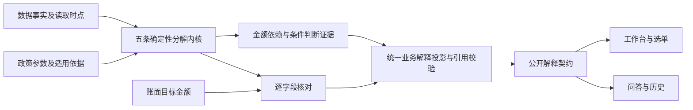

# 以费用分解串联数据事实与政策事实的解释改造方案

日期：2026-10-15，交互修订：2026-10-16。状态：工作台逐字段算法译文已实现；下一步交付按用户提供的医保结算样张明确为“完整结算事实在上、从费用明细到个人应付的正向结算路径在下”。完整路径展示尚未实现。本方案通过确定性费用分解回答“为什么是这个数”，在每个计算节点串联数据事实、政策依据及适用判断；中文字段名与结算单一致，默认简明解释，公开政策按需查看。依据：[字段解释设计评审](../../reviews/2026-10-15-fee-explanation-design-review.md)、[四类真实问题与当前交互评审](../../reviews/2026-10-15-xiehe-four-scenarios-product-review.md)、现有五条费用分解链路和产品入口约定。原始调研材料为 `D:/project/hospital_medical_insurance_agent/raw/协和数据/协和调研单据.pdf`；页码和脱敏问题摘要见后文。最新结算样张仅提取字段标签与金额关系，不在设计文档保存姓名、证件号或医保号。

## 目标与验收故事

本Agent以费用分解为核心：用户先通过**与结算字段同名的中文公式＋金额＋简短说明**大致理解“为什么是这个数”，有需要再展开组成、基数、比例、条件和依据。底层仍通过分解连接数据事实与政策事实；这些关联用于保证解释可靠，不要求用户阅读政策才能理解金额。账面核对用于检验解释，问答负责定位和组织同一份解释证据；找单、问题路由和人工交接为这条解释链服务。

核心验收故事：定位结算单后先展示账面事实，默认给出以个人应付为目标的分解主线；用户也可从全部公开业务字段任选一项查看来源。两种入口连接同一解释证据，回答：**结算记录是多少、本次能计算到哪里、采用哪些条件、用了哪些运算、每个关键输入和参数分别依据什么数据/政策、还有什么不能解释。** 用户继续问某个基数、比例或分支时，能定位到同一解释链的对应节点。记录无法独立重算时仍保留账面事实；存在差异时同时保留账面、计算值与有符号差额。

四类真实问题分别检验单笔解释、多笔解释链对比、退费重结算前后解释链对比和待遇分解；不能以工单完成、资料齐全或工具执行成功替代上述核心验收。票据效力及到账等不能由费用分解决定的子问题另列证据边界。

不创建新的业务入口，不增加前端费用公式，不改医保计算参数或放宽现有门控；不把执行记录包装成已经确认的待遇资格。解释关系需要的轨迹元数据可以补充，这与改变金额计算分开验收。本次设计补充包含问题路由、请求上下文、结构化核查结果和会话恢复，不能再把整个改造称为纯页面重构；新增外部支付/票据数据源和未经确认的退费算法均须单独落实。

当前推荐假设为：医保办/收费人员代患者受理，账面金额主显，问答聚焦问题、工作台保留全单。主要使用者尚待业务确认，不据患者手写申请表推定本期已包含患者自助产品。待遇核查需要读取本次有效的资格证据和结算类别，但不从缺失源数据或金额反推患者真实资格；候选待遇推断仍另期设计。

## 页面与信息分工

| 层次 | 展示内容 | 默认行为 |
|---|---|---|
| 结算事实区 | 参照原结算单的基本信息、待遇、交易金额、基金及补助、个人支付；使用原单中文字段名 | 默认展示双列结算信息，保留零值与缺失的区别；计算值不回填原始事实。费用明细通过页签查看，诊断仅在取得真实数据时展示。 |
| 本单采用条件 | 本次采用的险种/医疗类别/身份档/机构档/支付方式及证据状态 | 只展示实际取得或明确采用的条件，分别标记已确认、候选、条件输入、未知；不生成“真实资格已识别”的结论。 |
| 解释浏览区 | “结算路径”与“字段解释”两种查看方式，共享选中字段和解释证据 | 默认按实际支付顺序，从费用明细、目录划分逐步到个人应付；点金额或事实字段进入该节点解释。 |
| 选中字段解释 | 中文字段名＋金额构成、简短说明；进一步展开账面/计算差异、条件及来源 | 两个视图使用同一解释单元。字段名与结算展示一致，默认不讲解整套政策；计算性质和证据状态仍如实保留，不让用户自行拼接公式与依据。 |
| 条件与执行细节 | 当前节点关联的条件、中间计算及明细记录 | 在该节点内次级展开；完整业务字段统一由“全部字段”查看，不重复铺表。没有显式父子关系时只做分组，不称因果树。 |

问答回答、门诊/门特选单与工作台共用解释数据与展示单元，各入口保留自己的查询和默认展开范围。住院基础解释实现保留；四类问题可能涉及普通门诊、急诊、门特或住院，专用只读核查按实际记录侧别执行，不能一概套用五条门诊分解链。下文“历史”只指policy-qa会话轨迹恢复，不包含独立的`/qa-history`治理页。

在问答中有可靠的字段关联时聚焦该字段；暂未取得字段关联时显示总览和字段选择。四类问题增加轻量的问题选择与已选单据上下文，复用现有专用工作流，不引入通用问题识别引擎，更不能用问题文本改变分解计算。后端完整summary继续作为确定性回退，前端将其折叠为“完整核对摘要”，不再与全部卡片一起常显。

金额分组按业务含义确定：费用构成、个人责任、基金/补助、实际支付方式分别展示。起付属于自付一的构成，账户与现金属于支付方式，不重复加总。定额链路另注明医院定额基金口径，避免把它当成患者实际费用内的基金金额。

### 交互选择及理由：事实常驻、个人应付为主线、全部字段可直达

采用同一页面内的组合：**先完整展示结算事实，再顺着实际结算顺序理解个人应付如何形成；已知疑点可直接查任意字段。** “结算路径/字段解释”只是解释区的浏览切换，保留原有Agent切换与业务入口，不再增加新的工作区。个人应付是路径终点，不要求用户从最终金额逐层反向寻找全部计算；已实现的逐字段算法译文作为节点下钻内容保留。

| 选择 | 优点 | 单独采用时的局限 | 本方案取舍 |
|---|---|---|---|
| 事实字段→用户提问来源 | 先核对真实记录，适合已有明确疑点的业务人员，可直接进入任意字段 | 用户需先知道该问什么；金额间的依赖关系隐含，可能反复追问才能理解整笔费用 | 保留完整结算事实和字段解释入口；字段点击即可展开，不要求先打字或调用模型。 |
| 费用明细→实际结算顺序→个人应付，数字可展开 | 用户按费用如何划分、如何支付、如何补助的顺序理解最终金额，医保办可逐步定位疑点 | 全部明细和规则同时展开会过长；支付方式与医院定额还需单独说明 | 默认展示本单实际经过的主干、每步金额和简短理由，深层说明按需展开；个人应付作为终点，全部字段仍可直接定位。 |
| 两种入口连接同一证据 | 支持快速查字段和整体理解，切换不会形成不同答案 | 若各自读取/计算会造成重复和口径漂移 | 复用同一结果、读取时点及字段引用；切换只改变浏览与展开状态，不重算费用。 |

“全部字段”指本单已公开的业务字段范围，并非原始数据库全部列。已取得的事实可问其记录来源；计算参数可问规则与适用条件；仅观察到的支付/票据等字段可说明来源和解释边界。不支持的字段应说明未覆盖，不能暗示系统已解释全部数据库内容。

### 定位结算单后的默认页面

1. **先核对事实。** 顶部标明当前结算、日期、医疗类别和读取时点，参照原系统展示基本信息、结算时待遇及双列交易金额，账户/现金单独标为支付方式。采用允许公开的完整业务字段，零值照常显示，缺失显示“未返回”；姓名、证件、医保号按权限脱敏。事实区独立于算法是否支持，不将推算值填入原单。
2. **默认看到正向结算主干。** 从费用明细出发，先展示目录内外及先行自付划分，再按结算时有效待遇、机构条件和交易前累计所在阶段，依次展示起付、实际适用的统筹/大额、补助、大病/救助，最后汇总个人支付总金额和支付方式。每步显示本单输入、中文公式、结果及一句采用理由。只出现本单实际适用的流程，未执行、不适用与尚未确定分开标识；不将所有链路硬套成同一公式。最终等式置于路径末尾，顶部原单已提供个人支付金额作为定位信息。
3. **点字段或金额看细节。** 点选任一组成金额、基数、比例或事实字段，就地展开该项来源与计算说明；需要时再查看相关公开政策原文或带当前焦点追问，不主动将普通金额问题引向政策学习。
4. **明确问题优先。** 从某个字段问题进入，直接聚焦该字段并标出它在分解中的位置；纯找单进入才默认个人应付。不在责任主线上的独立字段展示自身来源并说明关系，不虚构主线位置。切换“全部字段”保留当前焦点和已展开内容，返回分解无需重新找单。
5. **整体逻辑可见、细节按需读取。** 默认展示主干轮廓与第一层金额，不常显所有条件、明细和政策原文。可以“展开本笔计算步骤”逐层查看已提供的显式关联；该动作不展开原始工具审计、模型内部推理或全部政策全文。

“先展示事实”首先是信息顺序和独立可用性，不要求新建一个重复查库接口。复用本次读取的数据投影事实与分解；金额算法不支持或解释缺口存在时，已取得的结算事实仍可查看。未查到单据与“查到单据但暂不能分解”分别提示；只有列表摘要时也不能冒充已取到全单字段。

### 2026-10-16 交付细化：先看原单，再顺着算到个人应付

第一屏保留医院人员熟悉的结算单结构，默认交易信息，费用明细按页签查看。字段名采用原单中文名称，原始金额与计算金额不混排；日期、医疗类别、当时有效待遇及累计阶段有来源才显示。诊断页签在取得真实诊断数据后提供。完整事实由结算记录提供，不能仅靠费用分解结果中目前恰好返回的字段拼接，更不能因算法不可用而把原单也隐藏。

下方使用纵向的本单结算路径，顺序为：费用明细 → 目录划分 → 起付 → 实际适用的统筹/大额支付 → 退休、军残、公疗等补助 → 大病 → 救助 → 个人支付总金额。账户和现金在终点之后列为支付方式。正常未适用的模块收为一行；已适用但支付为零、资格未知、缺少累计等分别说明，不能仅因零金额而宣称不享受待遇。

每一步采用相同的紧凑结构：**步骤名称与结果金额 → 中文公式 → 一句“本单为什么采用这个基数/比例/阶段” → 按需查看明细和来源。** 采用结算时的有效待遇和本笔发生前累计，不以当前最新身份或交易后累计替代。步骤由后端本单实际执行结果提供，前端不靠金额相等、公式名称或字段排列猜测因果及支付顺序。

目录划分中，药品、诊疗、材料逐项汇总形成医保内与医保外；自付二按对应链路口径归入医保外构成，不画成第三笔可再次相加的费用。若居民大病等通道的结算医保外金额已经经过支付调整，目录初始划分须标为计算中间量，与结算单医保外原值分别展示。

以下只用本次用户样张的金额说明页面读法，不表示已取得该单全部明细、交易前累计或独立待遇证据：

| 路径步骤 | 本单金额及中文运算 | 展示限制 |
|---|---|---|
| 目录划分 | 费用总金额 1916.72 元＝医疗保险范围内金额 1812.37 元＋医疗保险范围外金额 104.35 元；个人支付自付（二）金额记录为 104.35 元 | 要下钻至哪些收费项目、采用什么目录规则，仍需明细证据；此处只能串联样张金额。 |
| 起付 | 医疗保险范围内金额 1812.37 元－起付金额 838.56 元＝本次共付段费用 973.81 元 | 973.81 为计算中间量；838.56 的独立来源需要起付标准及本次之前的累计。 |
| 门诊大额 | 当次门诊大额基金支付金额 681.67 元；大额自付金额＝973.81－681.67＝292.14 元 | 按截图标注的 70%可复现基金金额；不能由反算比率认定该比例适用于本人。 |
| 补充支付 | 补助前医保内个人负担＝838.56＋292.14＝1130.70 元；扣单位补充医疗保险（原公疗）支付金额 644.76 元，得到个人支付自付（一）金额 485.94 元 | 1130.70 为中间量，不回填原单自付一；644.76 需按本人公疗待遇、累计、基数和限额逐步说明。仅有截图时标为引用结算金额。 |
| 个人应付 | 个人支付总金额＝个人支付自付（一）金额 485.94 元＋医疗保险范围外金额 104.35 元＝590.29 元 | 自付二已经包含在医保外，不再加一次。 |
| 支付方式 | 当次个人账户支付金额 590.29 元；当次个人现金支付金额 0.00 元 | 解释如何支付，不再扣减个人应付。 |

基金支付金额 1326.43 元＝门诊大额基金支付 681.67 元＋单位补充医疗保险支付 644.76 元。总费用减基金合计只作为另一条核对关系，不再重复扣公疗。默认呈现流程中的中文名称必须与上方结算单完全一致；表内为避免重复而使用的简称，正式页面须统一引用字段标签。

某步无法独立重算时，保留已取得的结算金额，标明“本步引用结算金额”，下游可以继续说明账面金额关系，但不能升级为完整独立重算。政策和数据来源仍放在节点的“查看依据”中，不要求用户读政策才能看懂主线。

### 项目与定额共用骨架，定额保留患者与医院两种口径

- 按项目：逐项目录划分后，依据有效待遇、起付及累计阶段完成基金和补助，再算个人应付。
- 混合定额：先确认定额管理范围，将“定额管理范围外、按项目付费”与“定额管理范围内、按定额付费”分组，按“先项目、后定额”计算，不将同单全部费用套成定额。
- 定额患者主线：以实际费用计算起付及各阶段个人自付，再依次计算各项补助、大病、救助，得到患者个人应付。肾移植链路适用的个人自付比例调整，应在对应阶段标明。
- 医院定额分组：另列核定定额、定额减原始自付后分配到统筹/大额的金额，以及各项医院垫付合计。其与患者实际费用主线有关联，但不把医院定额基金直接当成实际总费用内可相减的基金金额。日标准未核实时仍保留条件输入状态。

**落实前的两项明确缺口**：现有 `SettlementBillView` 主要从分解字段读取原单金额，需补齐独立完整的结算事实来源；现有职工门特 `_sum_details` 汇总的是明细已有医保内/外/先行自付，需如实区分“读取明细既有划分”与“按三大目录独立重算”。若要所有链路均独立核定目录划分，须另补数据与计算能力，不能仅修改页面措辞承诺已完成。

### 为什么个人应付主线仍需全部字段入口

| 字段类别 | 与个人应付的关系 | 页面位置 |
|---|---|---|
| 费用、起付、基金/补助及剩余责任 | 是个人责任计算的主要组成或上游依赖；具体关系随链路变化 | 分解主干与金额节点；全部字段可直达同一节点。 |
| 险种、年龄档、机构、医疗类别、资格时点等 | 决定规则选择，是条件依据，不能当金额相加 | “本单采用条件”及其影响的计算节点。 |
| 个人账户、现金/银行卡等 | 表示个人责任如何支付，其分配原因还需对应记录/规则 | 个人应付结果后的“支付方式”；与责任分解分别显示。 |
| 医院定额费用、医院基金等 | 属医院定额口径，与患者实际费用内基金可能不同 | 定额专属分组及关联说明，不塞进患者金额恒等式。 |
| 交易/票据状态及其他描述字段 | 帮助理解记录及有效状态，未必参与个人应付计算 | 全部字段的相应分组；按实际来源说明，不编造算式。 |

因此验收“所有字段都能进入”与“个人应付依赖是否完整”分别进行。共同依赖通过引用复用，不能为了把所有字段放进一棵树而伪造依赖关系。

### 统一字段解释与问答

默认只呈现本项中文名、金额及1—2句构成解释。点开后，两个视图共用以下解释层次，不各写一套金额或答案：

- **是什么**：业务含义及账面值；如果是中间量/参数，明确它不是结算原始字段。
- **怎么来**：最终算式、组成及计算值；有差异时同时展示有符号差额。描述性字段只解释记录/映射来源，不强行给出费用公式。
- **为什么这样算**：采用的条件与判断、基数/比例/分段/取整依据。
- **依据在哪里**：数据来源可查看；政策依据放入“查看依据”的次级入口，仅链接已核验的公开文件/条款并保留时点及确认状态，不强制弹出或在默认回答附长段原文。
- **解释到哪里**：未知、条件输入、仅账面等精确限制；零值可追问为何为零，缺失不转零。

选中字段后输入区显示可取消的焦点提示，例如“正在问：个人应付→军残补助”；用户可点击“为什么用这个比例”“这个基数包含哪些费用”等与已提供证据相符的快捷问题。问题文字不得代替结构化字段/步骤引用；清除焦点即回到本单问答，用户明确选择新字段时同步更新焦点。后端确保焦点属于当前结果，引用过期时说明并重新定位，不能按相同数字匹配到另一节点。

所有已取得且允许公开的来源与计算明细，点击即可查看。自然语言用于追问条件、归纳多个节点或跨笔差异，不给查看已有字段增加一次必需的模型等待。模型表述引用相同结果，数字、公式、来源状态及缺口仍由确定性输出约束。

### 中文公式、统一字段名与解释口径

以下为需求方明确的展示要求，应纳入首期验收：

1. **公式必须有中文含义。** 组成项统一显示“中文字段名＋金额＋单位”，主等式同时带上目标中文名与金额；长公式可分行，但加减方向和字段对应关系不可丢。不得只显示一串数字后要求用户点开才知道是什么。
2. **一项字段一套展示名称。** 结算事实、全部字段、公式、展开标题、输入焦点及解释文字使用同一公开中文名称。复用现有字段label及集中公开映射，不让前端或模型分别起名；如现有名称带核对状态，将状态独立展示，避免同一字段在不同位置换名。政策正式名称与结算简称不同，可在展开处说明对应关系，主公式沿用结算展示名称，不擅自把不同概念合并为一个简称。
3. **中间量明确标识。** 没有结算原字段的基数/小计采用有定义的中文名，并标明“计算中间量”，不冒充账面字段。显示映射不能改变原始公式及数值。
4. **先解释本次构成。** 默认说明“哪些费用构成这一项，减去了哪些补助，最后是多少”。避免常规回答以“依据某文件第几条”起头，或主动要求用户阅读政策。比例、范围、特殊条件等若会影响理解则保留；关键差异、缺证据或条件输入仍需简短就地提示。
5. **与政策保持语义和确定程度一致。** 可用短句解释，但待遇名称、费用范围、人员/机构/时间条件、比例与限额、支付顺序、例外及“可以/应当/不予”等限定不得被改写扩大。保持政策口径不等于照搬公文长句；不能用“通俗化”把“个人先行负担”改成“全额自费”，把本笔0支付改成无资格，或把条件核对改成已确认应享待遇。这里是措辞边界示例，不是对某项具体政策的新裁定。
6. **公开来源按需查。** 原文链接仅来自已核实、可公开查看的政策来源，指向实际支持本节点的内容；Issue、样本说明、内部讨论及未确认业务口径不得包装成公开政策。依据缺失时保留“计算口径待确认”等准确限制，不为了文案完整编造依据。
7. **默认解释可确定性输出。** 优先使用已校对的中文模板和本次字段/计算数据，模型可选组织语言。不能仅凭数字没变就接受润色；字段名、金额归属、加减方向、费用范围、适用条件和结论确定程度均须保持。无法保证时回退确定性模板，不新建第二个模型做无限文案审核。

609的展示示例（名称沿用本笔已有业务字段；仅演示已有运算，保留定额相关限制）：

```text
个人应付 68.85元
＝ 定额范围内原始自付一（含起付）1315.40元
－ 退休补助 7.70元
－ 军残补助 653.85元
－ 公疗补助 585.00元
```

默认简短说明可写为：“本次定额范围内原始自付一（含起付）为1315.40元，减去退休补助7.70元、军残补助653.85元和公疗补助585.00元后，个人应付为68.85元。”这段仅表述已有构成，不增加政策资格判断；必要的“定额条件尚待确认”等状态另以简短提示保留。该示例不能硬编码为其他病例的通用公式，其他实际存在的费用/大病/救助等项依本笔计算完整展示。

### 异常与缺失情况下的浏览

- 本笔无法分解：保留事实和“全部字段”，默认分解区解释原因及已知范围，不留下空白，也不把费用差额直接当成独立计算。
- 个人应付缺失但已算出候选值：事实区显示“结算记录未提供”；分解区单独显示计算值及限制，不回填账面值。
- 正常未命中/不适用模块：主干中简短说明或收在“本次未适用项目”；适用但为零、未知、阻断必须分别说明，避免把零支付等同于无待遇。
- 退费/负金额：按该链实际支持的“个人责任变动/退费”口径展示并保留方向，不取绝对值套正常缴费流程。
- 定额结算：患者责任主线和医院定额口径各自闭合，缺少日标准等条件时保留本笔限制。

### 双入口页面草图

```text
结算单事实  日期/类别/读取时点
[交易信息（默认）] [费用明细] [诊断信息（有数据时）]
脱敏基本信息 / 本次有效待遇
完整双列交易金额：费用、基金及补助、个人支付、账户与现金

[ 结算路径（默认） ]  [ 字段解释 ]

费用明细 → 目录划分 → 起付 → 统筹/大额 → 补助 → 大病/救助
          [每步显示输入、中文公式、结果、一句采用理由]
医院定额相关金额另组展示，与患者实际费用主线分开

个人应付：账面68.85元 / 当前计算68.85元
个人应付68.85元＝定额范围内原始自付一（含起付）1315.40元
               －退休补助7.70元－军残补助653.85元－公疗补助585.00元
              [每个中文字段及金额均可展开]
简短说明：本次由上述自付金额减去三项补助后，个人应付为68.85元。
支付方式：个人账户 … / 现金 …

选中节点的解释（就地展开）
本项来源及计算说明 / 必要条件和限制              [查看依据]

正在问：个人应付 → 已选节点  [取消焦点]
[为什么用这个比例] [这个基数从哪里来]
[输入追问……]                                      [发送]
```

草图数字沿用609的已记录算式，仅说明交互，不代表其定额/资格依据已完整确认。主干标签是模块示意，实施时根据当前profile和显式依赖展示，不据标签顺序制造父子关系。

“全部字段”按结算事实/费用责任、基金补助、支付方式、条件依据和其他记录分组；已分解字段点击后在统一解释中定位，独立字段展示其自身来源。桌面和窄屏均优先就地展开，复用现有details/summary或受控按钮，保持键盘可达及展开/收起状态；不新增图布局库、另一套聊天或通用卡片框架。

## 数据与公开契约

### 复用内部结果，集中生成公开解释



投影是纯函数：不查库、不调用模型、不改变金额；两个路由调用同一投影，不各自遍历新字段做文本替换。路由继续承担鉴权、公开模型校验与既有通用防护。

建议保留原金额字段，增补下列解释能力；实际命名在实施时沿用项目风格：

| 对象 | 需要的信息 | 约束 |
|---|---|---|
| 字段 | 原有金额/状态；reason、计算引用、精确来源和缺口关联；必要的条件关联 | 最终计算与支持步骤必须区分。没有最终步骤时不得把另一字段的result当本字段算式。 |
| 条件 | 安全的业务描述、比较含义、实际/期望的业务展示值、判断结果 | condition允许为空；没有记录就说明未提供。内部实现条件不得冒充待遇资格。 |
| 计算 | 目标与操作数的统一中文展示名、formula_version、可读算式、数值/单位、取整、结果 | 保留十进制字符串。中文名复用结算事实字段的公开名称；中间量单独标识。显示映射不另行算钱、补比例或猜未知公式。 |
| 来源 | 明确的公开标题、来源类别、确认状态、可选已验证政策文档链接 | 不从citation.kind自动批准任意ref；没有安全来源信息就不展示链接、不编造法条。样本说明不冒充正式政策。 |
| 缺口 | 安全中文消息、影响的字段、精确关联ID | 保留现有uncertainty关联；不能仅靠affected_fields大范围猜配。未知原因使用保守业务文案，不原样输出内部自由文本。 |
| 本次计算上下文 | 公开安全的模式名称、读取时点，必要时使用不含原始标识的本次结果引用 | 区分保守证据口径与候选评估口径；保守模式不表示所有规则已签核。模式与来源确认状态分开。使用已有模式与读取元数据，不新增患者画像或共享缓存系统。 |

### 每个金额节点必须连接哪些证据

现有字段、计算、分支、来源容器继续复用；补充显式关联和显示语义即可，不新建通用知识图谱或规则引擎。目标金额的必要依赖链属于首期交付。

| 解释要素 | 用户要追问的问题 | 最小关联要求 |
|---|---|---|
| 金额与最终步骤 | 这个数由哪些部分形成？ | 目标字段指向自己的最终计算；组成金额能够继续定位上游步骤。仅已知账面输入须明确标记，不伪装成已解释。 |
| 数据事实 | 基数、数量、限价、累计从哪里来？ | 操作数指向本单/明细/累计的安全业务引用、值、单位、业务时点及来源状态；相同数字出现在不同字段时仍分别关联。 |
| 政策依据 | 为什么用这个比例、门槛、封顶或次序？ | 被采用参数/规则指向对应条款或已确认业务依据及版本、确认状态；来源只支撑其实际表达的条件/参数，不能用一篇政策的标题支撑整条链。 |
| 适用判断 | 为什么本次落在这个档或这个分支？ | 条件中的实际事实与规则要求各有引用，判断结果指向其决定的计算；取整及分段规则同样可追溯。 |
| 上游关系 | 为什么这个输入又是这个数？ | 支持步骤与最终步骤分开；共享中间金额允许复用引用，不能按执行先后猜父子关系或为形成树而复制事实。 |
| 缺口与差异 | 解释卡在哪里，哪些结果受影响？ | 缺口指向具体输入/条件/规则/步骤及受影响金额；账面差异定位到最早可证差异层级，不笼统宣布全单正确或错误。 |

数据时间与政策适用时间逐项匹配：费用发生日、结算日、资格有效期、交易前累计与数据读取时点不能混为一个日期。依规则本身的时间口径选择依据，不将最新政策套回历史结算。

政策事实、候选口径和数学关系分别展示。加减恒等或账面残差可以有业务定义依据，但不需要编造一条“医保政策”来证明普通算术；按规则独立计算的参数则必须能说明为何取此值。若金额经目标字段绕回自身，必须降低为账面核对，不计入独立解释。

以609的68.85为例，第一层显示带中文字段名的原始自付一与三项补助构成（见前文示例）；第二层按需回答每个金额的来源、构成与对应条件；第三层允许查看公开依据。底层关联保持完整，普通用户不需要展开到第三层才能获得简明解释；现有定额条件限制仍保留。

新公开关联ID只用于结果内连接，不把物理路径作为展示名称。分支和操作数中的内部ref不直接公开；scope只投影成业务安全的本单/明细引用。未知模块回落“其他计算步骤”，不回显实现名。

来源与文本处理必须覆盖数组叶和实际值，不只处理description：原始value/values、操作数、scope、链接均在边界内。字段描述使用已有业务名称或明确展示映射；来源文本没有被批准为公开文本时不透传。前端纯文本渲染，来源链接只接受明确允许的协议与文档目标。

### 引用完整性与渐进解释

1. 后端统一建立字段、计算、分支、来源与缺口索引；兼容现有裸规则号与`rule.<id>`引用形式，不让前端重复做猜测匹配。
2. 相同内容的重复来源可合并；重复ID但内容不同视为关联歧义，不能任取一条。
3. 缺失引用仅降级受影响字段的解释。金额仍展示，展开时提示“未记录本步计算/依据尚未关联”。未提供轨迹不等于没有适用条件。
4. 支持步骤可以解释输入的来处，但不得替代字段最终步骤。统筹/大额自付等残差应记录本来已执行的减法；汇总和恒等也应有对应解释记录。
5. 一期不递归解释任意`calc.*`字符串；它可能只是中间量名。只有显式关系才链接，否则作为已知输入的业务值展示。
6. 规则来源未确认、条件输入或账面恒等不会因为增加图形而升级证据等级；继续尊重may_claim_full_explanation及字段不确定性。

允许修改内核的**轨迹元数据**：补最终/支持步骤、残差/汇总记录、字段关联与缺失关联的合理降级。费用公式、参数值、取整和适用范围冻结；回放金额及已有核对结论必须保持一致。

### 版本与旧结果

内部金融结果结构未改变时，内部`result.py`的schema_version保持1.0，不为公开页面增加可选字段而改所有原始回放版本。公开投影可以独立标识1.1，两个路由共用该公开版本。

前端兼容1.0旧历史和1.1新解释：缺键、null数组、未知状态和局部坏记录均保守降级；旧历史仍显示原金额与“此结果未提供解释详情”，不回查当前政策伪造当时解释。未知未来结构不能导致已能解析的金额全部消失。

首期不改变已有field_code的兼容语义，前端不将其作为业务标签展示。此选择保留了旧接口物理标识的历史债务，因此只能声称新增解释做了安全投影，不能声称整个旧公开接口已完全隔离物理标识。如果用户裁决面向患者、或本次必须彻底满足设计§12的全载荷隔离，则将公开字段码迁移纳入首期，并按破坏性语义变化设计新版契约与前端过渡；不要把它包装成纯增量1.1。

## 状态与交互规则

- 金额一致只表示相应核对成立。是否独立、是否依赖条件、政策是否签核分别展示。
- false表示条件未命中；not_applicable表示不适用，二者不默认计入异常。unknown、blocked和影响当前金额的证据缺口优先展开。
- 本笔无法计算时仍显示已取得的账面金额，计算值显示“暂未计算”并说明原因；缺失与零、未计算与不适用不混用。
- 默认先展开用户所选金额与其障碍，不以所有非true模块作为展开依据。每个规则的完整来源只在用户查看时展示。
- 每个计算步骤用业务语言说明“使用哪些事实，满足哪个条件，依据什么规则，产生哪个金额”。基数/比例/组成金额可就地展开其来处，规则引用落在它实际支撑的节点上。
- 连续追问保留本次结果、安全金额/步骤引用、目标明细及当前比较范围；“为什么是这个比例”先定位当前节点，不能仅凭关键词重新生成一篇通用政策回答。引用无法唯一定位时轻量澄清，不改动计算输入。
- 复用现有原生details/summary或受控展开按钮，打开后才挂载大量明细子节点。首期不新增图布局库、虚拟列表或通用渲染配置框架；大数据量测试发现需要时再确定优化。
- 普通分组列表不擅自添加ARIA tree角色；展开按钮有键盘可达性、明确名称和aria-expanded。未知或缺失节点不导致整块渲染崩溃。

## 单笔解释的三个落地切片

| 切片 | 最小完整产出 | 主要位置 | 完成门槛 |
|---|---|---|---|
| 1. 安全解释贯通 | 单个已有金额能在工作台显示安全的采用条件、最终计算/缺口、来源状态；原金额保留 | public_contract.py、public_view.py、两路由、前端共用解析、共享块 | 安全来源默认拒绝自由文本；引用缺失可降级；旧1.0结果可展示；核心金额例子不串公式。 |
| 2. 五链语义与轨迹补齐 | 五链关键字段的最终/支持步骤、残差/汇总与精确关联；可按模块/明细展开 | 各内核的轨迹构造点、展示名称映射、现有纯结果模型 | 五链金额回放不变；普通支付、自付残差、定额医院口径分开；未覆盖字段明确标出。 |
| 3. 所有挂载点与回归 | 选单、工作台、问答、追问、旧历史使用同一公开解释；默认密度按裁决落地 | FeeDecompositionBlock、相关工作区/回答块、stream与API读取 | 不重复常显全部摘要；模式差异可见；生产鉴权/配置门控、住院路径及错误回退保持。 |

第一切片可从609个人金额解释验证：账面68.85；已有计算为1315.40−7.70−653.85−585.00，且保留大病/救助及医保外项。应注明本笔定额相关限制，不能把医院定额基金210.60当成患者基本基金204.60，也不能据数额吻合声称所有待遇已确认。

本方案不新增第二套计算或数据仓库，不借页面重构引入新的患者画像、审批流或对账平台。首期必须补齐目标金额的必要依赖关系，以折叠算式和就地证据展示；图形化树布局在关系完整后另评估。单笔解释先建立核心能力，四类问题再复用、连接和对比同一分解证据，不把单笔解释降为独立工单链的附属功能。

## 受影响位置与复用要求

后端：`src/runtime/policy_qa/public_contract.py`、`fee_decomposition/public_view.py`、必要的轨迹构造点，`runtime/api/policy_qa_routes.py`和`fee_decomposition_routes.py`接同一公开投影。沿用确定性模板，保持金融结果不依赖模型润色。

前端：`src/lib/policy-qa-stream.ts`仍提供共享白名单解析`toFeeDecomposition`；`fee-decomposition-api.ts`保持原snake_case DTO职责，由工作台、选单等消费者继续调用共用解析，禁止维护第二套蛇形/驼峰转换。`fee-decomposition-block.tsx`复用解释展示单元；工作台、选单、回答与会话轨迹恢复各保留入口职责。

可借鉴CalculationDisclosure的渐进展开、PolicySourcesDialog的来源呈现和已有展开按钮样式，但不把不同DTO用类型断言硬接。金额保持Decimal字符串，格式化不得经普通浮点运算重新计算。

## 验证与真实案例

实施完成后先审查→查漏→修复→复审，再按项目要求依次Unit→API→Flow，最后做前端与真实页面验收。以下是计划，不是本轮已执行的测试。

| 类别 | 必须验证 |
|---|---|
| 公开边界 | 用虚构敏感样本测试带姓名/本地路径的来源、物理字段ref、数组文本、无效链接；新解释只保留安全业务信息。现有历史物理码债务单列。 |
| 关系正确性 | 最终计算与支持步骤不串；缺计算、缺来源、重复冲突ID、中间量ref均保守降级；condition为空可渲染。 |
| 状态与金额 | 零、null、不适用、未计算、差异负号、条件核对、候选规则、未签核状态均不被升级。正常FALSE不染异常。 |
| 五链用例 | 职工普通与居民普通各取已回放例子；居民退费保留负号；567普通门特；675候选公疗与账面差异；688分币差异；718年度累计缺口；609/814定额双口径；708资格未确认。 |
| 页面与历史 | 工作台、选单、对话、追问、多轮、1.0历史与1.1解释；未知模块、局部坏项、无轨迹不使原金额消失。 |
| 模式与权限 | 同一单号在不同EVAL模式下准确显示模式与解释范围；不放宽主链开关；401/403/503及按人多候选流程保持。 |
| 信息量 | 大明细、多轮消息，收起时不挂载全部子节点；问答首屏与继续追问可用。规模基于实际采样确定，不事先宣称已有性能问题。 |

后端沿用现有费用分解单元、两路由API及Policy QA Flow测试；前端补共享块、共用parser、工作台、`settlement-agent-workspace`、回答与会话轨迹恢复用例，执行相关Vitest、类型检查和构建。轨迹元数据变更后重新跑五链，覆盖既有157笔基线并纳入当前范围新增记录，比较每笔已有金额/核对状态及不确定性语义，不能只看总准确率。

真实页面验收通过`..\ws.ps1 up issue-78`启动指定工作区，通过`..\ws.ps1 url`取得地址，禁止写死3109或手动启动服务。验收本笔金额解释与工作台模式，再确认主问答原有门控和住院解释不受影响。

## 展示选择与待确认边界

1. 谁是首要使用者？推荐医保办业务人员优先。
2. 本方案采用事实区账面主显，选中节点同时显示计算与差异；算不出时保留事实。此项为本轮交互建议，不更改金额口径。
3. 本方案采用完整结算事实常驻、正向结算路径默认、任意字段直达；问答聚焦当前节点，工作台保留全单核对。两种视图共用同一结果和解释单元。
4. 待遇核查先读取有效登记、结算类别和支付事实；源数据缺失时的真实待遇推断仍另期，不以分摊金额吻合替代资格证据。
5. 退费到账、个人账户收支、财政电子票据状态及人工报销材料要求分别由哪个系统/责任部门提供？未落实的数据源按子问题缺口展示，不承诺自动判定。

主要使用者与外部来源落实后再调整对应范围；本轮已给出可落地的交互选择，不等待额外展示选项裁决。原始金额、未知纪律、安全来源和现有鉴权门控不作为可随意放宽的展示选项。

## 四类真实问题及解决边界

### 原始材料与证据等级

PDF共9页，为扫描图片，已逐页目视核对。第3—6页分别对应Q1—Q4；第1—2页是另附的费用/结算示例；第7—9页为就诊、特病及异地提示。没有证据证明第1—2页与四份申请为同一患者或同一交易，不强行关联。

以下金额属于患者陈述或扫描件记载，不能直接视为数据库核验结果。手写不清、涂改、票据对应关系和日期必须在受理时确认；第4页可辨年份为2026，不能沿用旧测试库年份替代。第7—9页提示的现行有效性未核实，不直接作为当前或历史交易的正式政策。

| 问题 | 原始需求与材料 | 用户最终需要的结果 | 仅改金额卡片是否足够 |
|---|---|---|---|
| Q1 同药多次结算差异 | 第3页：三次特病开药，记录总额7581.20/7581.20/7500.00，个人支付1774.68/1091.56/1087.50；患者认为同药报销比例不同。申请未提供药品代码及完整明细。 | 对齐同一药品/规格和三笔结算；区分总额、单价、数量、目录自付、结算类别、累计与补助差异；说明哪些差异能够解释个人支付变化。 | 不足：需要多单上下文、项目对齐及跨笔解释。 |
| Q2 退药后未退款反多扣 | 第4页：退一支胃镜麻药，患者表示未收到退款，反而多扣5元多。该差额是待核实诉求，非已证实流水。 | 找全原收、退费、重收及相关项目；区分收费结算变化、个人账户变化和现金/银行卡到账；回答多扣是否发生、原因是否可证。 | 不足：需要交易链和支付证据，单笔负费用不代表已到账。 |
| Q3 特病与救助是否生效 | 第5页：两天急诊，自述血友病特病及低保二次报销；其中一次总费用3140.30、个人支付1541.94，认为高于以往。 | 逐笔核实资格有效期、本次医疗类别/项目关联、基本与补助/大病/救助支付及剩余个人责任；解释未确认环节，不能仅罗列待遇金额。 | 部分可复用分解，但需要两次就诊与本次适用证据。 |
| Q4 退费后的起付线、收付与票据 | 第6页：无痛肠胃镜退费后同时询问起付线、费用收退关系、两张单据如何用于报销。手写日期/单据关系需确认。 | 三个子问题分别答复；说明原收、冲销、重收对应关系，核查起付线记账变化及实际收付，凭权威票据状态和办理要求提供材料指引。 | 不足：交易状态、起付线记账、资金到账、票据效力是不同证据。 |

### 在现有页面内组织问题

继续使用`/policy-qa`的“结算解释”工作区；保留“政策问答”和“运营问数”，不新增第四个Agent、案件管理应用或独立业务页面。费用分解工作台仍为治理/验证支撑页。

建议主流程为：**找到相关单据 → 看结算事实及中文费用构成 → 按需展开某项数字 → 对比或继续追问，必要时查看依据。** 自然语言问题、四类示例和直接点击字段都是入口；底层执行确定性分解并连接数据与政策事实，不强制用户先完成受理向导或逐条读政策。

- 提供“多次报销不一样”“退药后收付款”“特病/救助是否生效”“退费后的起付线和票据”四个问题示例。它们是同一工作区的起问快捷方式，不是四套强制向导；自然语言始终可用。
- 保留按人+日期找单及已有单号入口。用户知道日期/金额而不知道单号时，系统列出候选，不反复索要内部登记号；候选不足不默认“今天”无记录即无结算。接受明确日期范围并显示当前查询范围，扩大范围需由用户确认。
- 问题区显示“本次核查：哪类问题、哪些日期/几张单据、目标项目、尚缺什么”。多笔采用可取消选择的清单；单笔保持现有直接点选。跨单比较先按现有比较接口最多5张设计，超过时分组或澄清，不静默截断。
- 患者、单据、就诊和交易标识分开；门特同一djh的汇总不能当作多个独立就诊，票据号也不能直接当医保结算号。多单比较需要后端确认同人/同院授权范围；不能仅凭用户勾选即认定同人。
- 保留“不知道单号”的找单路径。复制文字可填入问题，结构化身份仍走受控请求，不落聊天正文、URL、日志或本地存储。患者唯一标识只供既有适配器的查询过滤；未来是否改用短期引用由现有鉴权/会话机制决定，不另建身份平台。
- 第一期不新增自动OCR/文件上传能力。工作人员可依据纸单输入必要线索，并标注“用户提供、未核验”；以后接OCR时仍需人工确认号码、日期、金额和单据归属，不能以识别文本替代系统记录。

现有`fetchPatientLookup`及带`patient_key`的列表查询仍把身份置于GET查询串，这不是已满足的安全条件。B1同步将身份定位、带身份的列表查询改为请求体承载的POST；不带身份的既有日期查询可保留GET。旧身份GET入口须有明确的拒绝/迁移响应，前后端及测试同批更新，不让新增核查继续依赖该URL路径。已有`resolve-person`可在其支持范围内复用，不为此新增持久化人员目录。

四类问题进入相同双入口页面；问题示例只负责选取相关单据和解释焦点，页面结构以前文“双入口页面草图”为准。多笔问题的补充原型：

```text
已选3笔结算事实  [添加/取消对比单据]
[结算路径] [字段解释]
目标金额及同层组成：按单据列对齐
某层首次可证差异 → 对应输入事实/条件/规则
[回到本笔分解] [继续问这个差异] [复制有依据的解释说明]
```

复杂结果可横向展开业务对比表；不要求在现有840px问答列中同时铺开所有字段。移动/窄屏保留列标题和单据身份，不以缩小字号解决信息量。

### Q1 多单同药差异

1. 选择同一患者至少2笔结算及目标药品/项目；先复用`settlement_ids`、费用明细Tool及`SAME_DRUG_COMPARE`。已有`settlement-explanation?compare_with=`可作基础结算比较，但它不等同于同药明细归因；分别明确支持的侧别和公开输出。
2. 先核对项目代码、规格、包装单位、数量、单价和发生日期。同名、同码但规格/单位不同、同单重复行或负数量冲销时不得直接拼接为一笔；无法对齐时保留歧义并请用户选择。展示未取到明细的单据，不能从比较中悄悄丢掉。
3. 每笔展示费用总额、医保内外、先行负担、个人责任及其支付方式、已取得的累计/待遇条件；对当前内核支持的单据复用已有分解。汇总个人支付占比必须标明分子分母，不能称为药品法定报销比例，不能把全单基金按比例分摊到药品。
4. 依次呈现“事实差异—证据支持的影响—尚不能归因的部分”。单价/数量不同是事实；只有当时政策、累计和适用条件支持时，才能判断其对个人支付的具体影响。禁止仅因费用明细一致就宣布三笔报销一致，或仅因报销不同就认定收费错误。
5. 目标金额可展开原有单笔解释。三笔分别可计算也不等于跨笔原因已证明；缺交易前累计时明确留下该缺口。

Q1主视图对齐同一目标金额的分解层级，指出单价/数量、目录处理、基数、累计档位或待遇参数在哪一步首次出现可证差异，并联动相关上游事实和规则。最终金额的各组成项差额可在闭合且不重复计算时展示；非线性分段、多个条件同时改变时，不凭简单差额给每个因素分配因果贡献。

### Q2 已发生退费与收付核查

1. 复用`WF_REFUND_VERIFICATION`及历史退费查询，按已确认原交易追查相关退费和重收。日期用于找单，不得将相关交易严格限制为同一天；跨日/跨年只读取可证关联，关联歧义时不把同人所有交易并为一条链。
2. 以业务时间线展示原收费→退费/冲正→重收费，各笔保留正负号、状态和项目；只将确认成功、属于该链的记录用于确定性汇总，失败、待处理、重复/冲销记录单独说明。
3. 分别核查费用变化、个人责任变化、个人账户变化、现金/银行卡收付。`fee_all`是费用总额，负总额不能直接解释为已退现金；“退费交易存在”不能升级为“退款已到账”。尚无账户/支付通道流水时明确对应缺口，不编造净扣款。
4. 若已取得充分收付证据，由后端生成带方向和口径的变动计算及来源。前端只展示，不自行做钱款相加。区分医保基金回冲、个人账户回冲、现金/银行卡退款与再次缴费，避免重复计入。
5. T7退费重算规则未落实时仅解释可核查的账务事实。退款核查不以官方预退费试算替代已发生交易；试算若后续需要，另走既有受控能力并清楚标为假设结果。

Q2首先解释原结算与已发生重结算的个人责任如何分解、哪个组成金额发生变化，以及变化节点采用什么事实和规则。交易时间线帮助选取正确版本；它本身不替代费用成因解释。责任金额变化解释成立而到账证据缺失时，应分别说明已解释与未核实部分。

### Q3 本次待遇适用与逐层支付

1. 对申请中两次急诊分别找单，先确认实际医疗类别/结算侧别。患有特病不等于每笔急诊费用均按门特结算，不因“血友病”关键词直接选择门特算法。
2. 以业务清单展示：特病登记及有效期、相关定点/审批证据、本笔实际结算类别、项目与病种的可证关联、救助身份类别及有效时点、所需累计口径。患者自述、源记录、本次明确采用的条件分开，不从支付结果反推身份。
3. 复用`get_benefit_stacking`取得账面分摊，复用支持链路的基本支付、补助、大病、医疗救助分解。已有Tool只陈述登记/分摊事实且缺完整有效期等证据，不能单靠该Tool声称已完成资格核验。
4. `dbzbs`为空不能自动认定无救助；`CIVIL_TYPE`须结合字典、适用时点和数据来源确认。现有Tool仍固定提示低保维度缺失，不能把这条固定提示当作已穷尽其他身份来源。
5. 展示每一层已观察支付、可独立计算支付、差异和剩余个人责任；未知金额保持未知。补充待遇、基本支付汇总和子项不得重复求和；“未支付”须区分记录为零、未取得记录、资格不适用和原因待查。
6. 符合503/504独立定额范围时调用现有肾移植定额链，保留定额条件限制；医院定额基金与患者费用内基金分开。不得为解释本例临时放宽取整、年度累计或资格门控。

Q3沿最终个人责任逐层追到基本支付、补助、大病、救助节点，再在具体节点展示资格事实和规则条件。已经计算出支付额后仍需回答“为何该层支付/为何为零”；外置的资格清单和政策列表只能辅助，不得与金额链脱节。

### Q4 起付线、收退与票据三个子问题

Q4复用Q2交易链，但公开回答必须保留三个独立子问题及各自状态，不能只回复“找到两笔退费”。

| 子问题 | 所需证据 | 缺失时的答复边界 |
|---|---|---|
| 起付线如何记账 | 原结算起付、本次冲销/重收及相应时点累计变化、当时适用规则 | 当前退费Tool只携带原交易起付等事实，不据此推断已返还、已恢复额度或再次收取正确。 |
| 是否另有缴费/为何资金变化 | 原收、退费、重收和支付通道/个人账户记录 | 可以陈述费用交易变化；实际到账/补缴未证实时单独待核实。 |
| 两张单据如何用于报销 | 票据号与交易的明确对应、开票/红冲/作废/换开状态、接收部门当时材料要求 | 交易有效不代表票据可用于人工报销；没有财务/票据权威来源时列出应核实材料与责任部门，不指定“最新一张即可”。 |

Q4的起付线及结算金额变化继续由费用分解解释；票据效力属于辅助事实/办理规则查询，单列结果与来源。费用解释不必等待票据通道全部接通才交付，也不能据费用计算吻合推断票据效力。

扫描件第7—9页可作为需要确认的医院提示材料，不能因为提及异地人工报销就把未核实的历史提示作为当前正式办理依据。

## 请求、路由、结果与会话的补充契约

### 复用已有能力并接通页面

| 已有能力 | 本次需要补齐的连接 | 不得误称已实现的结果 |
|---|---|---|
| 单笔分解、字段/来源/缺口 | 延续本方案前半部分安全投影 | 可重现账面不等于政策及资格全部成立。 |
| `PolicyQARequest.settlement_ids/id_card/visit_date` | 共用发送函数接收并传递结构化上下文；页面多选和定位数据接入同一链，身份不持久化 | 请求字段存在不等于当前页面可完成多单和退费调查。 |
| 三条专用工作流与领域节点 | 明确问题类型后优先选专用核查，不让`settlement_explain`固定mode提前截走；未确认问题时用轻量澄清 | 窄关键词能匹配不等于所有表达都能自动识别。 |
| 通用公开回答、字段解释 | 增加安全的多单比较/退费时间线/待遇核查和子问题结果，保留旧文本回退 | 不将未经投影的Tool输出dict直接塞进公开载荷。 |
| 挂起、恢复、升级医保办 | 核查范围和待办随现有会话恢复；复用既有人工交接 | 有“升级”按钮不等于接收人/SLA/处理结果已验证可用。 |

除前半部分列出的金额解释文件，问题核查涉及`settlement-agent-workspace.tsx`、`settlement-time-browser.tsx`、`use-policy-qa-stream.ts`、`policy-qa-settlement-list.ts`、`policy-qa-session.ts`与公开回答组件；后端涉及`policy_qa/models.py`、两类API定位/问答端点、`workflow/service.py`和`public_result.py`、必要的`settlement_record_lookup.py`与`adapters/data_supply/settlement_record_queries.py`。新外部能力经既有Tool绑定和adapters端口接入，相关单元/API/Flow、parser及会话组件夹具同步，不改相邻治理功能。

新增可选的问题类型与目标项目上下文，名称实施时遵循现有领域字典；复用已存在的多单和身份字段，不再维护另一套人员定位模型。Q4增加子问题选择/列表；用户一次问三问时逐项保留，不强迫拆成三个新会话。

路由顺序须为：既有权限与高风险执行检查→当前金额/步骤/比较范围的追问定位→明确/有足够依据的问题类型→所需取数与专用编排→确定性分解及其解释投影，普通政策/运营模式保留。专用工作流负责找到并组织输入，不产生绕过分解内核的另一份金额成因结论。已有Tool只能查到事实时，如实交付事实并定位解释缺口；不能通过改变Tab名称改变金融计算口径。

### 结构化公开结果与完成语义

在`PolicyQAPublicResult`中增量增加可选的问题上下文和比较结果，至少携带：问题类型、当前分解结果/目标金额/步骤的安全引用、目标项目、比较范围、已答子问题、缺口及影响；比较表/交易时间线引用其对应分解结果。涉及费用原因的回答与证据引用必须指向同一份分解输出，不能让通用answer、比较Tool和字段卡片各自形成不同解释。票据等辅助查询按来源单列，不设计任意JSON卡片渲染平台。

每个子问题必须区分已解释、仅核查到事实、待核实/未支持。整体`answer_status`和核验文案按用户问题完成情况生成，不能因所有工具运行成功就显示“各步骤均已核实”或“未发现异常”；事实查询结束与报销原因已确认分开。没有因果证据时，“已查明交易事实，原因尚待核实”是有效的部分结果，不能包装成整件问题已解决。

解释1.1的兼容原则延续；新增公开核查字段同步后端Pydantic、前端白名单parser、DTO和历史恢复，不更改内部费用结果版本。历史若缺新上下文，则标注为旧单笔解释，不据当前数据补造过去的核查范围。

### 连续处理与交接

- 会话保留问题类型、所选安全单据引用、目标项目、当前分解结果/金额/步骤焦点、已回答子问题和缺口；身份证/卡号原文不进localStorage或轨迹。后续身份不足时重新受控定位，不能为恢复便利保存原文。
- “这一次”“上一张”“两张都要”只在当前明确核查范围内解释；对象不唯一时提问确认。换人清空全部单据与旧请求结果，多单改为单笔须明确告知，不静默覆盖。
- 用户补充的资料保留来源状态，不因点击“确认”升级为权威资格。新增事实需要重新读取/核验时生成新一轮结果与读取时点，不改写旧答案。
- 复用现有挂起、恢复和升级能力；交接摘要包含原问题、相关单据、已查事实、未解决问题及所需证据。医保办为当前使用者时，提示实际应联系的收费/财务/医保接口维护责任部门，不机械地要求“请咨询医保办”。未核实组织路由时不声称已指派。
- “复制核查说明”只生成有来源、含限制的工作说明，不生成已获批准的退费指令或报销凭证。请求正式退费/冲正等仍转既有人工确认，不执行外部业务操作。

## 四类问题的实施顺序与验收

优先完成A：打通关键金额到数据事实、政策参数、适用判断和上游金额的可追问解释，再用B连接多笔/多版本并检验四类问题。A与B使用同一解释内核和证据结构；B中的支付/票据源未接通不阻断可成立的费用解释，也不据此宣称四类全部解决。

| 顺序 | 最小可验收故事 | 主要复用/修改点 | 验收证据 |
|---|---|---|---|
| A 核心解释链与双入口 | 找单后先显示事实，默认个人应付主干；任意公开字段可直达同一解释，并追问一个比例/基数 | 前述三个解释切片、事实投影、共享解释块、必要引用及当前焦点 | 两视图金额与依据一致，切换不重复读取/计算；解释不可用时事实仍保留；五链既有金额、核对状态及门控保持；609等保留条件限制。 |
| B1 问题上下文与路由 | 用户在结算页提交同药/退费/待遇问题能组织所需输入，引用同一分解证据，并补足多单或日期 | workspace/time-browser、`use-policy-qa-stream`、request、workflow/service、SSE路由 | 当前金额追问不丢焦点；请求包含必要结构化参数；专用路由未被mode遮蔽；同人范围、歧义澄清、旧单笔路径与高风险检查成立。 |
| B2 Q1与Q3核查 | 三笔同药对齐；两次急诊逐笔检查待遇适用及分摊 | 现有明细比较Tool、比较Skill、待遇Tool和五链内核、安全公开结果 | 事实差异与原因区分；缺明细/资格/累计时局部降级；急诊不误走门特；补助汇总不重复。 |
| B3 Q2与Q4核查 | 关联原收/退费/重收，并分别答复到账、起付和票据子问题 | 退费Tool/adapter扩展、只读支付/票据port接缝、同一公开结果和现有交接 | 日期不截断已证关联；交易存在不声称到账；起付与票据证据缺失明确；不得自动退款。 |
| B4 四类产品验收 | 业务人员不看物理字段，也能给出核查答复或准确交接缺口 | 页面、会话/历史、复制说明与已有升级路径 | 下表真实问题与不利路径逐项验收，不以单笔准确率替代。 |

实现测试按审查→查漏→修复→复审，再Unit→API→Flow，最后前端与页面验证。以下均为待实施验收要求，不是本次设计评审已经跑通的能力。

| 验收组 | 必须包含的用例与通过条件 |
|---|---|
| 默认展示 | 纯找单进入先看到账面事实与个人应付主干；不要求先发问。已有明确字段问题直接聚焦目标；主干仅第一层默认展开，不重复常显全量summary。 |
| 中文公式与名称一致 | 目标、各操作数均带与结算展示一致的中文名和金额单位；同一字段在事实区/公式/展开/问答焦点不换名。长名称、负号、零值及中间量可读，状态与名称分离，禁止只展示裸数字公式。 |
| 简明说明与政策口径 | 默认1—2句说明本次构成，无强制政策跳转；公开依据按需可查。用构造样例验证费用范围、条件、比例/限额、支付顺序及确定程度不因润色改变；不能把先行负担写成全额自费、零支付写成无资格、条件结果写成确定待遇。必要差异和限制不隐藏。 |
| 两种浏览一致 | 从事实字段、全部字段、个人应付组成和明细进入同一节点，金额/规则/来源状态一致；切换保留焦点和上下文，不触发第二套计算或用数字字符串猜关联。 |
| 全字段范围 | 非金额条件、支付方式、医院定额口径和其他记录均可找到且有来源/未覆盖说明；不强塞入个人应付恒等式；仅账面、零、缺失、未适用分别展示。 |
| 局部可用 | 已取得事实但分解不支持、个人应付缺失、局部引用断开、退费负金额、定额条件缺失：已知事实不消失，不从计算回填账面，不把方向/限定条件丢掉。 |
| 核心解释链 | 任一选定关键金额的最终计算、操作数事实、采用参数、适用判断、上游步骤与来源逐项对应；重复数值不串字段，跨期规则不串版本，候选来源不升级；仅有恒等式或目标金额循环依赖不能标独立解释。 |
| 沿链追问 | 选金额后问“为什么这个比例/基数”“这项补助为何为零”，保持当前结果和步骤；无法唯一定位则澄清；回复只引用对应节点的事实与规则，模型不可补算或改条件。 |
| 跨笔解释 | 同一目标金额在多笔分解中对齐；定位首次可证差异及下游影响。共同未知不当作相同待遇，多个条件/非线性变化不编造精确因素贡献。 |
| 原始需求回放 | Q1三笔、Q2退一支多扣诉求、Q3两天急诊、Q4三个子问题均可受理；本次尚未核实原申请与测试库交易的对应，PDF亦缺完整明细、收付和票据证据，不硬编码一个所谓正确原因。 |
| Q1 | 同药同规格与不同包装、同单重复项目、负数量冲销、一笔无明细、不同患者混选、不同累计条件；每一笔都保留，未确定对齐/原因时不输出全量一致。 |
| Q2 | 原收→整笔退→重收、跨日/跨年、重复/失败退费、多次部分退费、医保端有记录但支付流水缺失；费用变化与实际收付分别验证，不取绝对值凑净额。 |
| Q3 | 两笔不同结算类别、特病登记失效或未取到、救助身份字段部分缺失、合法零支付、年度累计滞后、503/504定额条件未确认；未知不归零，不由病名或金额选择待遇。 |
| Q4 | 起付线有原值但无冲销后累计、票据有效状态缺失/红冲、两张票据对应不明；三问逐项状态，不能用一个complete掩盖未解问题。 |
| 数值与支付口径 | PDF第2页总额1916.72、个人590.29且现金为0的示例用于校验“个人支付不等于现金”；基本支付汇总1326.43与大额681.67、单位补充644.76有包含关系，不重复相加。该页仅作独立结构样例，不关联Q1—Q4患者。金额计算仍全部在后端。 |
| API与公开契约 | 多单/日期参数前后贯通；mode与问题路由优先级；比较/时间线等新结构安全白名单、旧响应兼容；工具完成但问题未解不标全核实；来源或不确定性可追溯。 |
| 页面与会话 | 无单号按日期找单、多选后追问/取消一笔、换人中旧请求返回、挂起/恢复、旧历史缺新字段；身份原文不进入请求URL/聊天/轨迹/localStorage；键盘可操作。 |
| 金额回归 | 单笔五链既有157笔及新增范围回放；另运行既有Tool69同型Golden作为技术回归，不把其住院同码/2024退费交易冒充原PDF患者的2025/2026问题已解决。 |
| 人员试用 | 由实际医保办/收费人员尝试四类问题，记录独立完成、查证耗时、关键误解、说明可用性和人工接管；四类各一例仅为探索性验收，不能据此推断准确率或产品市场匹配。 |

本轮只更新设计与评审证据，不开发上述交互、不接新的支付或票据数据源，也不改变现有费用算法。未落实事项必须留在验收清单中，不因交付设计文档改为“已完成”。
