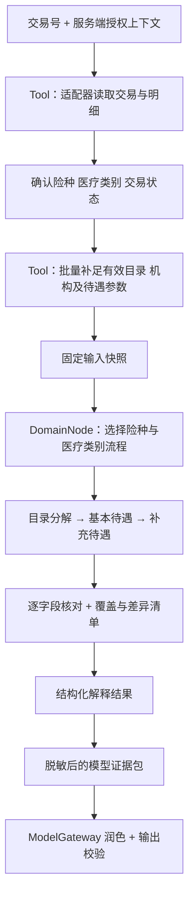

# Issue #78：按险种与医疗类别组织的结算费用分解设计

日期：2026-09-24  
状态：设计评审稿，待需求方确认；未开发  
首期：城镇职工基本医疗保险 × 普通门诊  
业务归属：`explain + settlement`

## 1. 设计结论

输入一个交易单号，系统自动读取结算事实、费用明细及相关目录和待遇依据，执行确定性费用分解；每次判断保留条件、实际值、命中结果、采用的规则和计算过程；最后逐字段与原结算金额核对，输出可供大模型表述的结构化解释证据。

采用两层组织：

- **险种＋医疗类别决定整体计算流程**：职工门诊、职工门特、居民门诊、居民门特分别有明确的流程函数。
- **费用分解模块复用**：目录范围、先行自付、起付线、分段支付、退休补助、军残、公疗、金额核对分别实现纯计算函数。共享模块不代表不同险种使用相同参数、适用条件或叠加次序。

首期只实现职工普通门诊；其他三种组合明确返回尚不支持，不套用职工门诊公式。退休补助、军残、公疗是首期需要覆盖的职工门诊分支；需求方已补充比例、顺序和日期依据（S9），字段映射、历史资格及分段归属仍须落地确认。

用户只需交易号，不代表内部只需要两张表。`o_Trade` 与 `o_FeeItem` 提供已发生事实，目录、机构、历史待遇参数补足“为什么”；账户和现金的具体分配，若缺少当时扣款规则或支付流水，只能说明实际支付构成。

**金额核对一致是解释成立的必要条件之一，不足以单独证明规则正确。** 禁止由目标金额反推比例、补差或选择恰好吻合的政策版本。

## 2. 依据与证据边界

| 编号 | 来源 | 本设计采用的内容 |
|---|---|---|
| S1 | [Issue #78：费用分解算法开发](https://github.com/ktyhwangfei/hospital_medical_insurance_agent/issues/78)，2026-09-24 读取正文，无评论 | 手工计算步骤、字段、关联表、候选公式、样本交易号 |
| S2 | 本次需求说明 | 交易号入口、解释已结算账单、可复用模块、分支记录、模型仅润色、先设计后开发 |
| S3 | `src/adapters/data_supply/settlement_record_queries.py` | 映射驱动、只读参数化查询、适配器边界；现有查询能力不能直接等同于本次完整数据契约 |
| S4 | `src/runtime/workflow/definitions.py`、`domain_nodes.py` | Tool 负责外部取数，DomainNode 负责确定性计算，OutputNode 明确输出来源 |
| S5 | `src/data_platform/outpatient_sync.py:_check_amounts`；`storage/postgresql/outpatient_store.py` | 已有交易/明细勾稽与字段映射；不能把同步质量检查当成完整费用成因解释 |
| S6 | `skills/settlement_explain_skill/calculator.py` | 已有计算器注册形态；当前存在浮点、缺值默认零、文本解析比例、默认退休系数，不适合作为本次可靠计算内核直接复用 |
| S7 | `docs/superpowers/specs/2026-08-26-mzsettlement-verify-skill-design.md` | 门诊单据解释范围、缺值不转零、明细口径待验证等既有设计 |
| S8 | `src/domain/AGENTS.md`；`docs/governance/TEST-VERIFICATION-MATRIX.md` | 领域语言、类型约束、验证要求 |
| S9 | 2026-09-24 本会话需求方补充的退休补充保险、残疾军人伤残补助、公费医疗补助结算规则 | 本设计 §7.5 的比例、计算顺序、资格条件、日期依据及住院边界；属于需求方提供的业务规则，正式文件出处待关联 |

以下是**软件设计建议**，不是新的医保政策裁定。S1 是业务需求及计算线索，不自动成为权威政策文件。S9 给出的业务比例直接进入设计，不再标记为未知；尚未查询真实数据库或验证样本金额，正式文件出处、适用时段、代码映射及未给出的参数仍须关联确认。

## 3. 范围与成功标准

### 3.1 首期目标

1. 在已授权院区内，交易号唯一定位一次职工门诊结算。
2. 按交易日期匹配目录，逐行分解总费用、医保内、医保外及自付二来源。
3. 记录人员身份、机构类别、年龄、起付线、支付档位和补充待遇的条件轨迹。
4. 独立重算已确认规则覆盖的金额，并与结算字段逐项对照。
5. 对不能重算的金额仍保留原始事实、可核对的关系及未解释原因。
6. 产出稳定、带版本、可回放的结构化结果；模型不可改变数字及结论等级。

### 3.2 本期不做

不执行正式结算、退费、冲正；不新增通用规则 DSL、动态插件平台或可视化流程编辑器；不开发其他三种组合；不修改政策知识治理门户；不自动猜测缺失政策。

## 4. 总体链路与现有架构接入



复用现有 Workflow 的节点模式，不把每个项目判断都变成 Workflow 节点。一个领域节点执行整笔分解，其内部产生细粒度轨迹。计算模块不查数据库、不调用模型。

建议增加一个“结算费用分解”Workflow，接入现有 `/policy-qa` 结算解释入口。Skill 可调用同一个领域服务，禁止另外维护一套公式。外层问答仍可接收 `question`，但算法输入不依赖问题文本；同一快照无论问哪个字段都得到同一计算结果。

当前 `settlement_data_provider.py:get_settlement_context` 面向住院语义对象，不能仅因同名 `settlement_id` 就用它读取门诊。`o_Trade.T_TradeNo`、医保端登记号 `djh`、医保结算 ID 必须保持显式映射，不能试查命中哪张表就认定是哪种单号。[来源：S3、S4及该文件]

## 5. 输入、数据契约与只读取数

### 5.1 公开输入

```json
{"settlement_id": "<o_Trade.T_TradeNo>"}
```

`hospital_code`、用户身份和读取权限来自服务端上下文，不能仅凭知道交易号就读取任意院区数据。险种、医疗类别、年龄、退休身份由数据决定，不要求用户填写，也不允许客户端覆盖。

### 5.2 需要的数据

| 数据组 | 主要来源/字段 | 用途与缺失处理 |
|---|---|---|
| 交易锚点 | `o_Trade.T_TradeNo`、`T_TradeDate`、状态及原交易关联字段 | 唯一性、时点、冲正识别；歧义时停止计算 |
| 分流 | `P_FundType`、`T_CureType` | 通过确认的码表转为标准险种/类别；未知不猜测 |
| 身份 | `PN_PersonType`、`P_Birthday`、特殊待遇资格字段 | 人员分支、结算时年龄；特殊资格字段需逐项确认，不按金额是否非零倒推 |
| 机构 | `T_HospCode → m_institution` 的机构键、`H_LEVEL` | 机构分支；Issue 未给连接键与历史版本，须确认 |
| 年度上下文 | `TB_FeeIn`、必要的年度基金累计/限额字段 | 起付、封顶；明确交易前/后、年度及累计范围 |
| 明细 | `T_TradeNo`、`ItemId/ItemNo` 候选行键、`ItemType`、`ItemCode`、`FeeType`、`UnitPrice`、`Count`、`Fee`、`FeeIn`、`FeeOut`、`SelfPay2` | 项目计算与观测值；行键及字段含义先验证 |
| 药品目录 | `yb_ypzdml.ypbm/sxrq/jzrq`、`sflb`、原自付比例、`a_ypbs/a_mzxj/a_zyxj/a_xbbl/ypfl/bzjg` | 目录分类、集采限价、自制剂；原自付比例实际列名待确认 |
| 非药品目录 | `yb_xzzlfwxm.xmbm/sxrq/jzrq/sfxmdj`、自付比例等 | 诊疗/材料分类；材料是否完整包含在本表中需确认 |
| 码表 | `yb_zdxm` 中 `flid='230'` 等已确认码表 | 解释药品分类，不代替金额规则 |
| 结算目标 | 下文 §10 的结算金额字段 | 仅作观测值/核对目标，不作为同一字段重算的输入 |
| 待遇参数 | 有效的起付线、支付比例、年龄档、封顶、补助资格/比例/基数/顺序 | 版本固定并有来源；缺项只阻断依赖它的分支 |
| 补充待遇历史 | 普通/预提退休标识、补充保险纳入日期、军残等级及资格有效期、公疗层级/统筹标识、在乡身份、本人定点机构关系 | 实际表列待映射；不以现时资格替代历史资格 |
| 日期与分段 | 真实结算日期、逐项费用发生日期、费用进入共付段及公疗门槛以上部分的分配依据 | 退休补助按结算日期、军残按费用发生日期；禁止混用或无依据分摊 |

物理字段名以适配器映射为准；Issue 中 `item_type/fee_type` 与源表 `ItemType/FeeType` 不直接混用。沿用现有数据供给连接和映射机制；首期可只读直查这些源表，不要求先完成全量语义治理。已有 PG 镜像只有在字段、历史目录和快照完整性满足同一契约时才可替换，不能混用不同时点的数据拼出“完整”结果。

### 5.3 一次读取的完整性

1. 参数化定位交易；按院区/数据源域检查唯一性。
2. 完整读取该交易全部明细，禁止分页截断后计算；重复行键报数据异常，不静默去重。
3. 按明细编码批量读取有效目录，避免每条明细一次 SQL。
4. 目录有效期条件放在关联条件或候选筛选中，保留未匹配的原明细。Issue 中 `LEFT JOIN` 后在 `WHERE` 过滤目录日期，会排除未命中的明细，不宜直接复制。
5. 同一明细命中 0 条目录记 `missing_catalog`；命中多条记 `ambiguous_catalog`。不能任取首条或重复展开费用。
6. 日期边界、空结束日期、日期与时间精度按源契约确认；不默认把空结束日期视为永久有效。
7. 在数据源支持时使用一致性只读事务；否则校验读取前后版本/更新时间，不能确认一致性则标记。记录读取时间、来源、行数、内容哈希及规则版本。

历史机构等级、目录或待遇资格缺少历史记录时，当前值不能冒充结算时值。年度累计优先取交易时快照；缺失时不能仅累加本院数据代替跨院累计。

## 6. 算法组织和模块接口

### 6.1 两级选择

顶层按标准 `(insurance_type, medical_category)` 精确选流程，首期只登记 `employee + outpatient`。原始险种码的映射尚未在 S1 给出，不能仅用 `T_CureType=11` 推断职工险种。

地区、政策生效日期、人员类别、机构类别是流程内参数选择维度；它们不会被简化成全平台固定比例。后续三个组合各自定义模块调用顺序和输入基数。

| 模块 | 主要输入 | 主要输出 | 复用边界 |
|---|---|---|---|
| 目录范围分解 | 明细、有效目录、目录规则 | 每行医保内外、先行自付子项、轨迹 | 药品/诊疗/材料共享结果结构，规则分别确认 |
| 起付线分解 | 合格基数、交易前累计、起付规则 | 本次起付承担、进入支付段金额 | 支持不同阈值与累计口径 |
| 基金分段支付 | 基数、累计、费率档、封顶规则 | 各段基金支付、个人承担、封顶承担 | 只复用分段运算，不复用未经确认的待遇 |
| 退休补充补助 | 退休资格、已确认基数、补助规则 | `T_BCPay` 候选计算值 | 每种流程明确参与条件与先后 |
| 军残补助 | 资格/等级、已确认基数、补助规则 | `T_JCPay` 候选计算值 | 不按退休身份或非零支付推断资格 |
| 公疗补充 | 公疗资格、已确认基数、补助规则 | `T_OfficalPay` 候选计算值 | 不默认覆盖全部剩余个人负担 |
| 汇总与核对 | 独立计算值、原始观测值、字段口径 | 字段级差异、覆盖、证据 | 各流程共享核对机制 |

模块输入为不可变业务值对象，输出包含 `amounts`、`branches`、`calculations`、`uncertainties` 和证据引用。简单纯函数加静态选择表即可，不引入只有一个实现的策略工厂。

公共代码复用的是**同一业务含义下的计算**。本期叠加顺序按 S9 明确为：大额支付 → 退休补助 → 军残补助 → 公疗补助。享受公疗的在乡残疾军人跳过军残补助。其他险种及类别不得自动继承这个顺序。

## 7. 职工门诊详细步骤

### 7.1 入口校验与身份判断

- 确认交易有效及属于支持组合。首期正向已结算单参与完整重算；冲正、退款、部分退费或负明细进入明确的未支持重算状态，返回可读事实与原因，不取绝对值套正向公式。
- S1 的在职候选代码：`11,12,40`。
- S1 的退休候选代码：`21,22,25,26,41,42,54,56,61,62,63,64,65,66,67,68,71,72,73,74,75,76,77,78,81,82,83,84,85,86,87,88,92,93,94,95,96,97,98,99`。
- 上述集合应有确认版本；其他代码为未知，不默认在职。退休不自动等于具有退休补助资格。
- S1 提出 `H_LEVEL=14` 为社区、`H_LEVEL<14` 为医院；仅对确认属于该码表的有效值使用，空值、异常值及其他等级为未知。
- 退休年龄以交易日期与出生日期计算已满周岁，不以当前日期计算；年龄阈值、生日当日与闰日口径纳入参数和边界测试。

### 7.2 三大目录逐项分解

每行先保存账面 `Fee/FeeIn/FeeOut/SelfPay2`，独立计算值另存。`Fee` 与 `UnitPrice×Count` 分开校验，不能无条件替代：源端可能有折扣、单位换算或取整。

**药品：`ItemType=0`**

1. 按交易时点匹配药品目录，记录命中依据。
2. 按已确认的 `FeeType/sflb` 判断甲乙丙或其他类别；二者冲突时按确认的优先级处理，未确认则停在未知。
3. 普通目录药品按有效原自付比例计算；全自费类按确认规则全额归医保外。
4. 集采标识 `a_ypbs=1` 时比较同单位单价与门诊限价 `a_mzxj`。本流程不使用住院 `a_zyxj`。
5. S1 记录“超过限价：原自付比例＋超限价上浮比例”；必须确认 `a_xbbl` 究竟保存增量比例还是最终比例，以及新比例作用于整项费用还是超价部分。未确认前不编码成正式公式。
6. `ypfl∈{16,6}` 自制剂候选规则：单价 `≤bzjg` 方可按目录待遇纳入，`>bzjg` 整项自费。[来源：S1] `ypfl` 代码含义及与集采规则重叠时的优先次序须确认；不能把“超过则全自费”改成“只超价部分自费”。

**非药品：`ItemType≠0` 且该值有效**

1. 匹配 `yb_xzzlfwxm` 等经确认的诊疗/材料目录。
2. `sfxmdj=1` 无自付、`2` 有自付、`3` 全自付为 S1 的候选规则；`2` 仍须取得实际比例及基数。
3. `sfxmdj` 为空必须返回未知。S1 的“空无自付（猜测）”不得进入正式算法。
4. 材料限价、限用条件与单位换算无依据时，保留未解释金额；不得以“非药品”标签宣称已完整支持所有材料。

**互斥金额与非互斥标签分开**：每笔原始费用只分配一次到最终金额桶；“乙类”“集采”“超限价”可同时作为解释标签，但不能把三个标签金额再次求和当作总费用。

自付二与 `FeeOut` 是否重叠，以及 `FeeIn` 是扣先自付前还是后的口径，必须用数据字典和样本确认。内部记录 `self_pay_2` 作为可追踪子项，不预先认定它是 `FeeIn+FeeOut` 之外的第三项，防止重复计入个人负担。

### 7.3 起付线

定义 `E` 为本次确认口径下的合格费用基数，`A` 为同年度交易前同口径累计，`D` 为适用起付标准。

若政策确认起付按该费用累计计算，则建议公式：

```text
本次起付承担 F = min(E, max(D - A, 0))
进入后续支付段 B = E - F
```

上述是待确认口径下的参数化公式，不是已确认的本地政策。`TB_FeeIn` 只有在证明是交易前累计后才能作为 `A`。若是交易后累计，必须有可靠本次增量才能还原，不能盲目减 `T_FeeIn`。累计含本次与否、年度重置、负值异常均保留判断轨迹。

`T_FirstPay` 为核对目标，不用于反推出 `D` 或覆盖计算的 `F`。

### 7.4 门诊大额支付与大额个人承担

由确认的身份、机构、年龄、政策时点选支付规则，规则可能单段或多段。不能通过 `T_BigPay/B` 反求适用比例。

在无封顶且规则确认只含一个支付段时：

```text
大额支付 = 按确认取整规则(B × 基金支付比例 r)
大额个人承担 = B - 大额支付
```

存在跨档时，对本次费用与各年度区间的交集分别计算：`segment_amount=max(0,min(A+E,upper)-max(A,lower))`。只有 `A/E/upper/lower` 口径一致时该公式可用；起付段已排除则不得再次扣起付。

基金封顶与费用封顶分开：基金限额使用历史基金已支付累计，不能拿费用累计替代。封顶以上个人承担是否进入 `T_BigSelfPay` 或独立 `T_BeyondBig`，须先确认字段口径，再汇总；不把差额自动归入大额自付。

### 7.5 退休补充、军残、公疗

本节比例与先后顺序来源于 S9。各模块统一执行：

```text
检查资格 → 检查规则时点 → 确定不重叠的计算基数
→ 应用比例/限额 → 记录支付与基数去向 → 核对对应结算字段
```

- 资格确定不满足：`not_applicable`；如果结算已有非零支付，另报资格与账面冲突。
- 资格未知：`unknown`，不得当作不享受。
- 资格满足但必需数据或规则参数缺失：保留原始金额，`observed_only`；下游独立重算若依赖该金额则阻断。
- 账面金额为零只证明实际未支付，不证明没有资格、未达条件或比例为零。

#### 7.5.1 统一基数与计算顺序

定义 `S` 为**门诊大额共付段**个人自付金额，`R` 为退休补助，`J` 为军残补助，`O` 为公疗补助。`S` 不包含起付线以下、医保外以及未经确认纳入共付段的封顶以上费用；只有确认 `T_BigSelfPay` 与该基数完全一致时，才建立对应映射。重算使用计算得到的 `S`，账面 `T_BigSelfPay` 仍独立作为对照。

```text
大额共付段自付 S
  → 退休补助 R
  → 剩余共付段自付 S - R
  → 军残补助 J（公疗在乡残疾军人明确跳过）
  → 公疗补助 O（按医保内累计超过 1300 元的适用部分补足目标待遇）
```

公疗基数和大额共付段不一定相同：1300 元是 S9 的公疗待遇累计门槛，不得据此替换基本医保起付标准。必须保留分段金额及各基金在该段的支付归属，不能直接对整笔剩余自付乘 95% 或 90%。

#### 7.5.2 退休补充保险补助

| 退休类别 | 计算基数 | 补助比例 | 计算值 |
|---|---|---|---|
| 普通退休人员 | 门诊大额共付段个人自付 `S` | 50% | `R = round_policy(S × 0.50)` |
| 原社会化退休人员（预提退休人员） | 同上 | 60% | `R = round_policy(S × 0.60)` |

`round_policy` 表示已确认的取整规则，具体模式和逐段/汇总取整尚待确认。

开始纳入补充保险的资格时点以**就诊交费的结算日期**判断，不按费用发生日期，也不按查询当天判断。[来源：S9]

需要取得：普通/预提退休类别、纳入补充保险起始日期、真实结算日期及适用规则版本。候选 `T_TradeDate` 是否就是所需结算日期必须核实；不能仅凭名称确定。日期等于起始日期按“起始日纳入”的设计解释处理，实施前用起始日前/当日样本确认；若源业务约定不同则显式版本化。

退休身份已知但普通/预提类别未知时不默认 50%；补充保险开始日期缺失时不默认已纳入。

#### 7.5.3 残疾军人伤残补助

| 身份 | 伤残等级 | 计算基数 | 比例 | 计算值 |
|---|---|---|---|---|
| 在职 | 5–6 级 | `S` | 70% | `J = round_policy(S × 0.70)` |
| 在职 | 1–4 级 | `S` | 100% | `J = S` |
| 退休 | 5–6 级 | `S - R` | 50% | `J = round_policy((S - R) × 0.50)` |
| 退休 | 1–4 级 | `S - R` | 100% | `J = S - R` |

退休军残必须依赖退休补助的独立计算结果；`R` 未知时不得用零代替。退休补助明确不适用时 `R=0` 可以继续，但必须保留不适用依据。

是否可分解军残补充，以**普通门急诊费用发生日期**确定。[来源：S9] 因而快照必须区分结算日期与明细费用发生日期。跨资格生效日的交易按明细发生日期分组，只有资格适用组参与该补助；不能以较晚的结算日期覆盖所有明细。

这要求把大额共付段自付及退休补助保留到对应费用分组。若源数据/业务规则无法确定跨日费用在起付段、共付段的分配顺序，则该笔军残金额标记不可独立核验，不能自行按金额比例摊分。费用发生日期字段、资格历史记录及组内取整顺序是待确认的数据契约。

享受公疗的在乡残疾军人不执行本模块，记录 `not_applicable`，原因 `RURAL_DISABLED_VETERAN_PUBLIC_MEDICAL_EXCLUSION`，转到 §7.5.4 的公疗 100% 分支。该排除条件优先于军残等级计算；资格未知且会改变路径时，不默认执行军残。

S9 提及普通门急诊，首期只上线已定义的普通门诊组合；急诊原始代码及与普通门诊的同流程映射确认前不自动扩展路由。

#### 7.5.4 单位补充险（原公疗）补助

资格前提：参加基本医疗保险的市级公费医疗人员，或参加市级统筹的区级公费医疗人员，且费用发生在**本人定点医疗机构**。本人定点资格与“医院是否医保定点机构”不同，需取得对应人员的有效定点关系。[来源：S9]

| 分支 | 已明确的前置支付顺序 | 医保内年度累计超过 1300 元部分的最终基金目标比例 |
|---|---|---|
| 一般公疗退休人员 | 大额 → 退休补助 → 军残补助 → 公疗 | 95%，个人承担 5% |
| 一般公疗在职人员 | 大额 → 退休补助（不适用则跳过）→ 军残补助 → 公疗 | 90%，个人承担 10% |
| 享受公疗的在乡残疾军人 | 大额 → 退休补助 → 公疗；不再结算军残补助 | 100%，个人承担 0%；累计 1300 元（含）以下不支付公疗补助 |

令 `A_in` 为交易前同年度医保内费用累计，`E_in` 为本次同口径医保内费用。对正向交易，落在公疗门槛以上的本次费用为：

```text
G = max(A_in + E_in - 1300, 0) - max(A_in - 1300, 0)
```

`G` 还须具备本分支资格及本人定点条件。若交易内资格混合，不得先筛掉不适用费用后重算累计位置；先按确认规则确定年度区间，再取符合资格的交集。`A_in` 与 §7.3 的 `A` 只有在口径确认相同时才可复用。

以下是根据 S9“包含公疗后达到目标比例”推导的**待黄金样本验证的实现公式**：

```text
q = 0.95 / 0.90 / 1.00（按分支选择）
target_fund_G = round_policy(G × q)
prior_fund_G = 大额、退休补助、军残补助在 G 对应费用段上已计算的支付合计
O = target_fund_G - prior_fund_G
```

在乡残疾军人分支中，`prior_fund_G` 不含军残支付。不能把整笔 `T_BigPay/T_BCPay/T_JCPay` 不分段直接从 `G×q` 中扣除，也不能用实际 `T_OfficalPay` 反求补助金额。

`O` 在 `[0, G-prior_fund_G]` 内才是正常补足结果。若已有基金支付超过目标，保留冲突与负差额诊断，不输出负补助，也不擅自冲减已有基金；“超过目标时补助归零、维持更高待遇”等处理需另有确认规则。一般公疗人员累计 1300 元以下的具体处理，S9 未像在乡分支一样明示，先列为待确认，不推定另有补助。

1300 元不等于“整笔个人支付保留 1300 元”。例如仅用于解释区间的算术例：交易前累计 1200、本次医保内 300，则门槛以上部分 `G=200`；基金目标应用于这 200 元，不能应用于全部 300 元。

#### 7.5.5 补助链算术示例与住院边界

以下只验证补助公式组合，假设日期、资格均满足，未涉及公疗：

| 示例 | 共付段自付 S | 退休补助 R | 军残补助 J | 补助后该段剩余个人自付 |
|---|---:|---:|---:|---:|
| 普通退休、5–6 级军残 | 100.00 | 50.00 | 25.00 | 25.00 |
| 预提退休、5–6 级军残 | 100.00 | 60.00 | 20.00 | 20.00 |
| 普通退休、1–4 级军残 | 100.00 | 50.00 | 50.00 | 0.00 |
| 在职、5–6 级军残 | 100.00 | 0.00（不适用） | 70.00 | 30.00 |

享受公疗的在乡残疾军人不套上述军残示例，按公疗分支补足适用段到 100%。

S9 同时给出住院规则：公疗人员跨年度或跨周期住院，先按基本医保政策结算，再**以交易为单位**计算公疗补充支付。本次将其记录为后续住院流程约束，不应用门诊 1300 元门槛或 90%/95% 比例推算住院，也不把多笔住院交易合并后统一补助。

### 7.6 最终汇总

汇总模块使用可追溯的计算结果，不从原结算目标补缺以伪装完整重算。可以另做“用观测金额验证等式”的账面核对，但它必须显式标注 `identity_check`。

## 8. 分支与计算轨迹

每个执行到的条件使用三值逻辑：`true / false / unknown`。父分支未进入时子分支为 `not_evaluated` 并注明原因，不能记为 `false`。上游缺失为 `blocked`，规则不适用为 `not_applicable`，两者区分。

| 轨迹字段 | 含义 |
|---|---|
| `step_id / parent_step_id / module_id` | 稳定步骤标识及层次 |
| `scope_ref` | 交易或具体明细行的引用 |
| `condition` | 条件代码、中文含义、比较操作及左右值 |
| `outcome / reason_code` | 判断结果及原因 |
| `input_refs / rule_refs` | 数据字段/目录记录/规则版本引用 |
| `calculation_refs` | 命中后产生的计算步骤 |

计算记录另外保留 `formula_id`、公式版本、操作数的引用和值、未取整结果、取整规则及最终金额。前端可展示算式文本，但文本不是运行时可执行表达式，不使用 `eval`。

例如在职人员：退休条件记录 `false`；退休年龄档判断记录 `not_evaluated`，原因是退休前提不满足。目录缺失时集采判断记录 `unknown` 或依赖阻断，不能写“非集采药”。

## 9. 精度、版本和回放

- 金额、比例、数量使用 `Decimal`；从数据库 Decimal 或十进制字符串构造，不经过 float。
- 金额对外统一十进制字符串，例如 `"123.45"`；比例例如 `"0.80"`；币种 CNY。
- 按确认规则明确逐行取整、逐段取整和最终汇总取整；取整模式必须有版本，不凭习惯默认某种模式再视为准确。
- 正式吻合按确认精度判断；例如到分结算，建议 `difference == 0.00` 才为 `matched`。一分钱差异也保留，不自动抹平；确有政策认可的容差时另列 `within_tolerance`，不得改写差额。
- 固定 `algorithm_version`、规则/目录版本、字段映射版本、输入快照哈希及读取时间。业务结果在相同输入下确定；运行 ID、时间可不同。
- 回放依赖实际保存的最小必要快照，哈希本身不能用于回放。首期复用现有轨迹存储与授权策略；若容量不足才新增专用持久化，不建立第二套审计平台。
- 规则来源区分 `issue_note / approved_business_rule / policy_document / source_catalog`。实验性规则即使吻合，也不能升级为已确认政策解释。

## 10. 逐字段解释与核对矩阵

所有目标字段都生成结果项，包括零值和缺失值。字段之间有包含关系，表中金额不能纵向求和。

| 目标 | 独立解释/计算路径 | 账面核对及注意事项 |
|---|---|---|
| `T_FeeAll` 总费用 | 有效原始明细 `ΣFee` | 对照 `T_FeeIn+T_FeeOut`；不由总费用倒推明细 |
| `T_FeeIn` 医保内 | `Σ` 独立目录分解医保内 | 同时核对 `ΣFeeIn`，显示目录计算、明细账面、交易账面三层差异 |
| `T_FeeOut` 医保外 | `Σ` 独立目录分解医保外 | 同上；自付二归属未确认则不宣称完成 |
| `T_SelfPay2` 自付二 | 独立计算各行先行自付 | S1：`Σo_FeeItem.SelfPay2`；只求原始字段和属于明细汇总核对 |
| `T_FirstPay` 本次起付承担 | §7.3 | 缺累计/阈值则无法独立计算 |
| `T_BigPay` 大额支付 | §7.4 | 比例、机构、年龄、封顶证据齐全 |
| `T_BigSelfPay` 大额个人自付 | §7.4 中已确认范围的个人承担 | 核实是否含封顶以上，不自动包揽差额 |
| `T_BCPay` 退休补充补助 | §7.5.2：共付段自付的 50%/60% | 区分普通/预提退休，以结算日期判断纳入资格 |
| `T_JCPay` 军残支付 | §7.5.3：身份、等级及剩余基数 | 退休先扣退休补助；按费用发生日期判断资格；公疗在乡军残排除 |
| `T_OfficalPay` 公疗补充支付 | §7.5 | S1 自付一公式旁误标“大额基金”，这里保留物理字段名并待确认中文口径 |
| `T_SelfPay1` 自付一 | S1 候选：`T_FeeIn-T_BigPay-T_OfficalPay` | 需确认不扣退休/军残补助的原因；不等同于最终个人应付 |
| `T_FundPay` 基金合计 | S1 候选：`BigPay+BCPay+JCPay+OfficalPay` | 必须检查本单是否另有基金渠道，遗漏非零渠道则候选公式不适用 |
| `T_SelfPayAll` 最终个人承担 | S1 候选：`FirstPay+FeeOut+BigSelfPay-BCPay-JCPay-OfficalPay` | 再与 `FeeAll-FundPay` 独立核对；先核实先行自付与封顶归属 |
| `T_PersonCountPay` 账户支付 | 有当时余额、资格及扣款规则时可重放 | 否则仅报告账面渠道金额，不反推支付意愿 |
| `T_CashPay` 现金支付 | 有实际支付规则/流水时解释分配原因 | `SelfPayAll=PersonCountPay+CashPay` 只证明渠道加总一致 |

核对类型固定区分：

1. `independent_recalculation`：费用事实＋规则独立计算，对照目标金额。
2. `detail_aggregation`：明细已记金额汇总，对照交易汇总。
3. `identity_check`：原始账面字段之间满足等式，不证明各字段原因。

不得把同一目标字段经由上游原始目标绕一圈算回自身。每项记录依赖图；例如退休补助只读了账面金额，下游最终个人承担即使吻合，也只能是混合事实核对，不能标独立重算成功。

核对结果：`matched / mismatched / not_verifiable / not_applicable`。`difference` 统一为 `calculated - observed`。未知目标值不是零；完整性不足的明细合计不得作为完整合计。

总体另设两条状态轴：`execution_status=complete/partial/unavailable` 与 `reconciliation_status=matched/mismatched/not_verifiable`。发现不一致不代表程序失败；“全部流程执行完但存在差异”合法。业务公开结果只有必需字段证据完整、独立重算通过、关键分支无未知时才可声明完整解释，否则保留部分解释和差异。

## 11. 面向模型的规范结果

建议结果名 `SettlementDecompositionResult`，对外 Pydantic 契约；新增领域术语在实施时登记通用语言字典。以下为结构示例，数字仅为演示，不是 Issue 样本实算。

```json
{
  "schema_version": "1.0",
  "algorithm_version": "employee_outpatient_v1",
  "settlement_ref": "settlement:example",
  "profile": {"insurance_type": "employee", "medical_category": "outpatient"},
  "execution_status": "partial",
  "reconciliation_status": "not_verifiable",
  "fields": [
    {
      "field_code": "T_FeeAll",
      "label": "总费用",
      "observed_amount": "100.00",
      "calculated_amount": "100.00",
      "difference": "0.00",
      "check_type": "detail_aggregation",
      "check_status": "matched",
      "explanation_level": "amount_reconciled",
      "calculation_refs": ["calc.total"],
      "citation_refs": ["fact.trade.total", "fact.items.total"]
    },
    {
      "field_code": "T_BCPay",
      "label": "退休补充保险补助",
      "observed_amount": "8.00",
      "calculated_amount": null,
      "difference": null,
      "check_type": "independent_recalculation",
      "check_status": "not_verifiable",
      "explanation_level": "observed_only",
      "calculation_refs": [],
      "citation_refs": ["fact.trade.bc"],
      "uncertainty_refs": ["u.bc.rule"]
    }
  ],
  "branches": [
    {
      "step_id": "eligibility.retired",
      "module_id": "person_classification",
      "condition": {"operator": "in", "actual_value": "21", "expected_ref": "rule.retired_codes"},
      "outcome": "true",
      "input_refs": ["fact.trade.person_type"],
      "rule_refs": ["rule.retired_codes"]
    }
  ],
  "calculations": [
    {"calculation_id": "calc.total", "formula_id": "sum_item_fee_v1", "input_refs": ["fact.items.total"], "result": "100.00", "rounding": "source_amounts_unchanged"}
  ],
  "citations": [
    {"id": "fact.trade.total", "kind": "settlement_fact", "ref": "snapshot:example/trade/T_FeeAll", "value": "100.00"},
    {"id": "fact.items.total", "kind": "fee_facts", "ref": "snapshot:example/items/Fee", "values": ["40.00", "60.00"]},
    {"id": "fact.trade.bc", "kind": "settlement_fact", "ref": "snapshot:example/trade/T_BCPay", "value": "8.00"},
    {"id": "fact.trade.person_type", "kind": "settlement_fact", "ref": "snapshot:example/trade/PN_PersonType", "value": "21"},
    {"id": "rule.retired_codes", "kind": "issue_note", "ref": "https://github.com/ktyhwangfei/hospital_medical_insurance_agent/issues/78", "approval_status": "pending"}
  ],
  "uncertainties": [
    {"id": "u.bc.rule", "code": "MISSING_BENEFIT_ELIGIBILITY", "affected_fields": ["T_BCPay"], "message": "已知普通退休补助为50%、预提退休为60%，但本单缺少退休类别和补充保险纳入日期，尚不能确定适用分支。"}
  ],
  "coverage": {"target_field_count": 2, "independently_explained_count": 0, "amount_reconciled_count": 1, "observed_only_count": 1},
  "answer_constraints": {"may_claim_full_explanation": false, "may_infer_missing_rules": false}
}
```

实际结果包含 §10 全部目标；示例只展示两项。解释等级使用 `causally_explained / amount_reconciled / observed_only / unexplained`，分别代表完整因果证据、仅金额关系吻合、仅原始观测、无法解释。未经确认的 Issue 规则不计入 `causally_explained`。

内部审计结果保留完整明细及字段定位；模型证据包默认只包含问题相关字段、依赖计算和必要分支摘要。大单据完整明细另存授权轨迹，通过证据 ID 定位，避免把全表塞进提示词；摘要必须保留总行数、覆盖范围和被省略数量，不能因截断变成“全部解释”。

## 12. 模型输出边界与展示

模型通过 `ModelGateway` 接收已脱敏证据包，只负责语言组织：

- 已完整解释：表述原因、计算基数、比例、结果及对应依据。
- 仅勾稽吻合：说“明细合计与结算记录一致”，不能说“医保报销政策计算正确”。
- 存在差异：原样保留实际值、计算值、差额和最早发生差异的层级，不擅自判定医保系统错误。
- 存在缺项：明确缺哪个规则或数据、影响哪个金额。不能用通常比例补全。

优先让模型输出带 `field_refs/step_refs/citation_refs` 的解释段落，由程序渲染金额与算式，减少自由生成数字。校验引用存在、金额未变、部分状态未被夸大；校验失败或模型不可用时使用确定性模板输出，已计算结果不丢失。

患者姓名、身份证、原始出生日期不进入模型；仅提供必要的结算时年龄或年龄档，交易标识使用授权引用。目录名称和政策文本视为数据，不作为模型指令。用户端呈现业务名称，物理表/列和 SQL 留在受权限控制的审计视图。

建议展示三层：总览（基金/个人与核对状态）→ 字段卡片（如何算、差多少、缺什么）→ 条件轨迹（为什么进入或跳过分支）。账户与现金在“支付方式”区，起付/自费/比例承担在“费用责任”区，避免相加两次。

## 13. 最小实现落点与兼容

以下为拟新增/修改位置，当前不创建代码：

| 位置 | 职责 |
|---|---|
| `src/domain/insurance/fee_decomposition.py`（拟新增） | 输入快照、条件轨迹、计算记录等不可变业务值对象；实施前核对既有命名并登记字典 |
| `src/runtime/policy_qa/fee_decomposition/`（拟新增） | 结果契约、流程选择、职工门诊流程、共享纯计算函数及核对服务；按实际复杂度拆文件 |
| `src/adapters/data_supply/` | 复用连接/映射，增加交易快照与有效目录读取能力，不让领域代码接触 SQL |
| `src/runtime/workflow/domain_nodes.py`、相关 Tool/Workflow 注册 | 接入一次取数、一次领域分解、明确输出来源 |
| 现有结算解释 Skill/模型组装位置 | 使用同一结构化结果，保留对其他既有场景的兼容 |
| 现有任务/轨迹存储 | 记录版本、快照、分支及核对结果，先验证序列化与容量 |

首期不需要独立公开 REST API：复用现有问答入口与内部强类型服务。外层仍遵循 `AgentResponse` 和既有 SSE `result/done` 契约；新增结果结构采用明确版本，不改变旧字段含义。未来若有独立核验客户端，再增加薄 API。

上线按 Workflow 已有启停能力控制。回滚关闭新分解流程；既有解释若不具备等价重算能力，必须仍标明其能力边界，不能退回默认比例计算后显示完整解释。代码及 Skill 制品变动按既有版本治理同步升级。

## 14. 验证与验收计划

本次仅文档审查。实施后先审查需求覆盖和 diff、查漏修复、再审查，随后按 **单元 → API → Flow** 串行验证；涉及领域模型按 R4 要求提供设计及兼容性说明。[来源：S8]

| 层级 | 必验场景 |
|---|---|
| 单元：目录 | 药品/非药品、甲乙丙、目录无命中/多命中、生效/失效边界、空等级、字段冲突、材料缺规则 |
| 单元：限价 | 集采低于/等于/高于限价；自制剂等于/高于标准；单位不一致；特殊规则重叠；比例异常 |
| 单元：待遇 | 在职/退休/未知；生日边界；社区/医院/未知；起付线前/跨线/线上；跨费率段/封顶；补助适用/不适用/未知/顺序缺失 |
| 单元：退休与军残 | 普通/预提退休 50%/60%；结算日位于纳入日前/当日/后；军残四种身份等级组合；退休军残先扣退休补助；发生日期与结算日期跨资格日；跨日分配依据缺失时阻断 |
| 单元：公疗 | 本人定点/非本人定点/未知；累计低于/等于/跨过/超过 1300；退休 95%/在职 90%/在乡军残 100%；在乡分支跳过军残；已有支付超过目标的冲突；禁止扣除适用段之外的基金支付 |
| 单元：核对 | 零与缺失、每层一分钱差异、禁止反推、禁止自付二重复计入、未覆盖非零基金、部分明细缺失 |
| 单元：数据边界 | 重复明细、负明细/冲正、跨年累计、读取中数据变化、历史目录缺失 |
| API | 交易号输入、权限与院区、歧义/不存在、字符串金额、结果 Schema、引用完整、异常响应契约 |
| Flow | 真实形态数据→适配器→算法→核对→模型/模板→SSE；partial 与差异不丢失；模型故障及越界生成降级 |
| 真实黄金样本 | 业务确认每个目标金额、适用分支及规则，冻结脱敏快照并回放；不能只断言最终总额 |

S1 的候选样本：`011100030X241118000008`、`011100030X241126000017`、`011100030X240913000067`、`011100030X251113008202`、`011100030X260417003528`。它们目前只是定位线索，不代表已验证覆盖某分支。实施时按真实查询结果标注覆盖，并补足缺失边界样本。

验收要求：

1. 支持组合及关键分支均有已确认样本；不支持组合不会走错公式。
2. 每个目标字段都有结果项，每个独立计算值可追溯到事实、参数、规则和取整过程。
3. 黄金样本逐字段符合确认口径；人为改变一项输入时相应分支/差异正确变化。
4. 所有必需分支具备规则与数据时才能称完整解释；未完成特殊待遇不能靠样本恰好为零隐藏。
5. 模型关闭仍能提供金额和条件解释；模型开启不能改变确定性结果。
6. 同快照同版本回放结果一致；授权/脱敏、既有问答场景与 SSE 结束语义不回归。

## 15. 分步实施计划（仅在设计获同意后执行）

| 顺序 | 最小可验证交付 | 完成依据 |
|---|---|---|
| 1 | 交易号→完整事实快照→账面字段及明细核对 | 数据口径签核、样本可回放；清楚标注暂未独立解释 |
| 2 | 三大目录逐行分解 | 每行内外/自付二可追溯；集采、自制剂和目录异常有边界测试 |
| 3 | 职工门诊起付＋大额支付 | 年度累计、身份/年龄/机构、费率及封顶分支核对通过 |
| 4 | 补充待遇及最终费用责任闭环 | 退休/军残/公疗有完整规则和样本，叠加次序确认 |
| 5 | Workflow/Skill 复用结果＋模型表述＋用户端解释 | API/Flow 全链路验证、脱敏与降级通过 |

每步可独立验证，但第 1～3 步完成不等于整个职工门诊算法完成。特殊分支暂缺规则可以发布标记清楚的部分解释能力，不能以此代替首期完整验收。

后续每新增一种组合：先给该组合手工黄金案例与参数口径 → 确认可复用模块和差异 → 新增一个明确流程 → 复用同一结果/核对/模型契约。至少第二个流程实际需要时才提取额外公共逻辑。

## 16. 评审时需要确认的业务口径

架构可先评审，以下是实施相应模块前必须补齐的清单，不要求现在一次回答全部。

| 优先级 | 待确认事项 | 不确认的影响 |
|---|---|---|
| P0 | `P_FundType` 的职工/居民代码、`T_CureType` 的普通门诊/门特代码及地区适用范围 | 不能安全选择算法 |
| P0 | `FeeIn/FeeOut/SelfPay2` 与汇总同名字段的包含关系、原始金额与单价数量口径 | 不能可靠分解目录和个人承担 |
| P0 | `TB_FeeIn` 是否交易前累计、年度范围、是否跨院累计；起付标准 | 不能重算起付金额 |
| P0 | 在职/退休、机构、年龄的实际费率及时间版本；封顶口径和字段归属 | 不能重算大额支付 |
| P0 | 集采 `a_xbbl` 是最终比例还是增量、作用基数、等于限价分支；与自制剂规则优先次序 | 特殊药品分解不能确定 |
| P0 | 普通/预提退休、军残等级/在乡身份、公疗类别及本人定点关系的实际字段与历史资格；补充保险纳入日期、结算日期和费用发生日期的映射 | S9 已明确比例和顺序，但缺少数据时不能判定本单分支 |
| P0 | 共付段与公疗超过 1300 元部分的费用/基金归属、跨日资格费用进入各段的顺序、逐段及汇总取整规则 | 不能用整笔基金支付替代适用段支付，也不能自行比例摊分 |
| P0 | 一般公疗 1300 元及以下部分的处理、已有待遇超过 90%/95% 目标的处理、公疗资格及本人定点关系的判定时点 | 不自行生成负补助或削减已享待遇；对应边界暂不能完整解释 |
| P0 | S1 自付一公式、基金渠道是否穷尽、自付全款公式对封顶/特殊渠道的适用范围 | 可能出现重复或遗漏金额 |
| P1 | 机构连接键及历史等级、非药品/材料目录覆盖、自付比例物理列、空目录日期/等级语义 | 对应分支保留未知 |
| P1 | 各步取整模式、对账精度；账户/现金分配规则与流水是否可查询 | 尾差与支付方式只能部分解释 |

本次已据 S9 补入退休 50%/60%、军残四类比例、退休先扣补充保险、公疗后算及在乡军残排除规则；不再把这些业务规则列作待提供。设计仍待整体同意，尚未开发。实施第一步用 Issue 样本确认字段映射及分段公式，没有依据的分支明确保留未知，不通过调参数把结算数字凑平。
